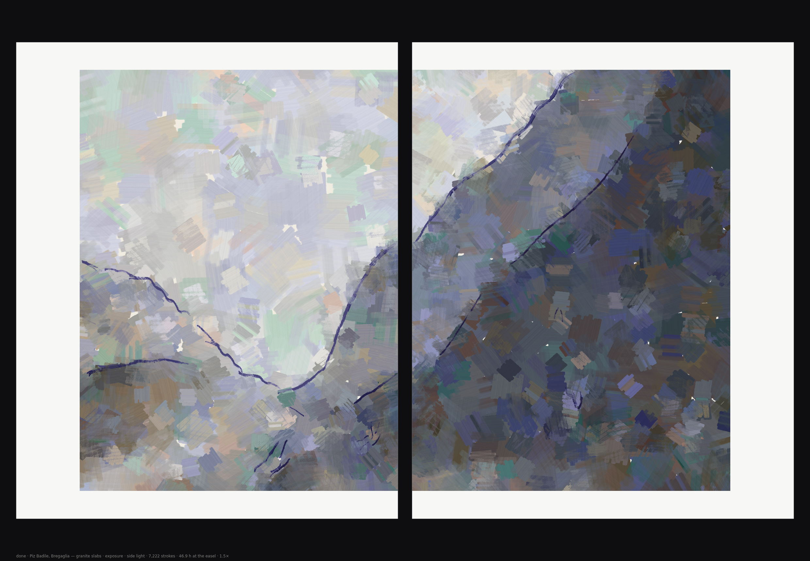

# 039 — Ridge, encounters — stroke by stroke

Oil (v1–v2) and watercolour (v3), each painted physically, stroke by stroke or wash by wash.
v4 adds a second oil manner, **constructive** (after Cézanne's late Mont Sainte-Victoire canvases).

**Mechanism (one sentence):** the scene of [028 — Ridge, encounters](../028-ridge-encounters/)
(coloured by [038](../038-ridge-encounters-painted/)'s bridge) is painted in oil one stroke
after another. A painter looks at the canvas before every stroke and chooses where, which mix
and which way to go. Paint behaves as paint while each stroke is laid: it mixes as pigment,
blends into wet paint, covers dry paint, runs out and breaks into dry brush.

The same seed gives the same scene as 028 (v1.4) and 038. 028's engine and 038's bridge are
loaded from their folders, not copied. 028 is frozen; **039 depends on 038's `bridge.js` and
`tools.js`** (for `mixRGB`), so a change there changes 039's subject.

## Why

036–038 plan every stroke up front from the target picture and blend colours on screen. The
brush never runs out, nothing smears, and no stroke sees the ones before it. 039 asks what
changes when the order and state of the paint are real.

## The paint (`paint.js`)

- **Pigments.** Nine oil colours plus medium:
  - titanium white, ivory black, ultramarine, cerulean, burnt umber, burnt sienna, yellow
    ochre, cadmium red light, Naples yellow;
  - each defined as a painter would test it: masstone (thick) and tint (1 : 4 with white);
  - absorption **K** and scattering **S** are solved from those two by the two-constant
    Kubelka–Munk method, with one S per pigment. With S per channel, a yellow over a dark
    ground turned green.
- **Colour is computed, never blended.** A pixel's colour is its wet layer's K and S at its
  thickness over the dried colour beneath (Kubelka's layer formula). So:
  - ultramarine and ochre make green; black and ochre make olive;
  - a medium-rich layer is a transparent glaze;
  - a thick white-rich layer hides what is under it.
- **The canvas, per pixel:**
  - the wet layer (volume of each pigment and of medium);
  - the dried layers' colour;
  - paint height;
  - when it was last painted;
  - a linen weave (tooth).
- **The brush:** a flat bristle brush, each bristle with its own load and stiffness. Loading
  it is uneven (a brushful is never perfectly mixed).
- **A stroke, bristle by bristle and pixel by pixel:**
  1. the bristle picks up wet paint that earlier strokes left, the more the fresher it is
     (open time), and carries it on;
  2. it then lays paint from what it holds, in proportion to how loaded it still is, so a
     stroke runs out;
  3. a spent or lightly pressed bristle reaches only the tops of the weave and skips in runs
     along the stroke (dry brush).
- **Brush shapes**, as a painter keeps them, differ in how the footprint answers pressure:
  - **flat:** square-ended, nearly the same width whatever the pressure (blocks, planes);
  - **filbert:** lands narrow and opens as it is pressed (oval ends);
  - **round:** a touch is a thin line, pressed it swells, lifted it leaves a pointed tail.

  The bristles waver a little across the footprint. (v1's single flat brush left the finest
  strokes as small rectangles.)
- **Time and drying.**
  - **Clock.** There is a painting clock in minutes. Each stroke takes about half a second plus
    a second per 200 px. Each dip into the palette, each wipe and each new mix takes its time.
  - **Drying.** Each pixel's wet layer dries on its own schedule: about 6 h × (0.3 +
    thickness) × (0.2 + 2 × fatness), divided by the drying speed. Thin lean paint dries in
    hours, thick fat paint in a day or more.
  - **Setting.** As paint sets, the brush picks up less of it, falling with time over about
    a third of its drying time.
  - **When it dries.** Every quarter hour of painting, whatever has had its time dries: it
    joins the dried colour and relief, and what goes over it glazes or covers instead of
    mixing in.
  - **Sessions.** The painting stands overnight (18 h) after the block-in. (v1 dried
    everything at once at a session's end and counted open time in strokes.)
- **Fat over lean.**
  - Each session's paint carries more oil than the one under it: block-in 0.08 (turpentine),
    body 0.25, detail 0.35, lights 0.42.
  - A layer that dries leaner than the one under it keeps a strain, recorded per pixel.
  - The `layers` control can break the rule (lean over fat), and the painting then cracks
    early.
- **Age.** The age control (years) dries the painting through, then ages it:
  - **Yellowing:** the oil yellows where there is more of it, and the varnish yellows over
    everything.
  - **Craquelure:** islands on a warped jittered grid, opening in patches and more in thick
    paint, from about 30 years.
  - **Early drying cracks:** wide and dark, wherever lean was laid over fat, within years.
- **Display:** a raking light over the paint's height (stroke ridges, impasto, the weave where
  paint is thin), with a sheen on paint that is still wet.
- **Resolution.** Each sheet is painted at its picture size × the canvas resolution. On auto,
  that is as many pixels as the screen shows, in 0.5 steps from 1× to 1.5×.
  - Brushes, the weave and the light scale with it, so a 1.5× painting is the same painting,
    finer.
  - While a sheet is painted, its state takes about 120 MB at 1× and 250 MB at 1.5×. 2× can be
    chosen and takes about 700 MB.
  - When a sheet is finished, only its image is kept.

## Watercolour (`water.js`, `wpainter.js`)

The medium control switches to watercolour: the same scene, painted with water on paper.

### Water and paper (`water.js`)

After Curtis et al., *Computer-Generated Watercolor* (SIGGRAPH 1997), simplified to run in a
browser.

**Two grids:**
- **Coarse grid** (3-pixel cells at 1×): water and the pigment suspended in it move here. One
  pixel per step reached too short a distance and was too slow.
- **Per pixel:** the paper's cold-pressed grain, the exact wet edge and the settled pigment.

**Every tick:**
- **Flow.** Water flows between wet cells and levels.
  - Dry paper takes water only from a very wet neighbour, so a wash keeps its edge.
  - Damp paper takes it readily (wet into wet).
  - Paper that has dried does not take water back.
- **Carrying.** Pigment travels with the water and diffuses through it, all but none in a thin
  film.
- **Evaporation and edges.** Water evaporates almost uniformly, so a wash's edge stays where it
  is while it thins. Pigment that reaches an edge against paper that was dry before the wash
  settles faster: the hard, dark edge of a dried wash.
- **Settling.** Pigment settles slowly while the water is deep and fast as it thins. A
  granulating pigment (ultramarine, cerulean, umber) settles more into the hollows of the grain.
- **Lifting.** Water on damp paper lifts a little of the settling pigment, the less staining the
  pigment the more. Water dropped into a wash pushes pigment out into a bloom.

**Seven watercolour pigments,** with their granulation and staining. Colour is their
Kubelka–Munk absorption, with little scattering, as a transparent layer over the paper. There
is no white paint: the paper is the light.

### The watercolourist (`wpainter.js`)

Watercolour can only darken, so:
1. **Reserved lights.** The lights of the subject stay as bare paper; no wash goes over them.
2. **The sky, wet into wet.** It is flooded evenly with clear water, and its wash is laid into
   the wet.
3. **Four layers of washes,** broad to small, each dried before the next is decided.
   - **Shapes.** The places still too light, smoothed into shapes and split by hue, are the
     washes. Small shapes get one only if clearly too light.
   - **The mix** for a wash is chosen for where it lands, and anchored to the hue it makes on
     clean paper (weighted 0.35, so a dark can still be neutralised with an earth).
   - **Grading.** The pigment is graded pixel by pixel to reach the lightness wanted there.
   - **Aim.** Each layer aims short of the subject (60 %, 85 %, then all the way): a wash cannot
     be undone, and the next can always go further.

### Found by measuring while building

- **Small strokes don't make a wash.** Thousands of small strokes each dried alone with its own
  hard edge: a patchwork. A watercolour is a few washes of shapes. This sheet now takes about
  40–90 washes.
- **Overlap doubled the pigment.** Wash strokes checked only where they started, crossed about a
  dozen others' work, and doubled it. 75 % of pixels ended too dark after four bands.
- **Hue compensation (twice).**
  - Colour dropped into the sky stroke by stroke cancelled warm with teal and cool with orange.
  - Anchoring the hue fully sent a dark bluer with every layer.
- **Dampness.** Paper stayed "damp" for hours after its water had gone, and every later stroke
  lifted the pigment under it: holes, and rings where it settled again.
- **Receding fronts.** Edge darkening applied at fronts that were only receding as the wash
  dried laid a ring at each step and a dot where the front ended. Isolated by drying a uniform
  wash on its own: it dried clean.
- **The picture's edge.** The last row of cells, cut by the edge, was given water as if whole,
  ran half as deep again, and dried as a line along the bottom.

## The painter (`painter.js`)

**Sessions**, as an alla prima oil is painted:
1. Toned ground: white-primed linen with a thin warm imprimatura (umber, sienna, ochre).
2. Block-in: one broad brush, lean paint over everything; it is let dry.
3. Body: two brushes, wet into wet.
4. Detail: a fine brush, wet into wet.
5. Loaded lights: thick paint in the lightest places.

**For each brush** (after Hertzmann 1998):
- the subject is softened to the brush's scale;
- the canvas is compared with it in OKLab;
- a stroke starts at the worst pixel of every cell whose error is above the tolerance.

**Order:** a painter mixes a colour and lays it everywhere it belongs, so places are taken by
colour, darkest first and lights last.

**Each stroke:**
- **Look again:** if the place has been put right since the pass began, it is skipped.
- **Mix:** the nearest mix on the palette to the subject there. Its value is pushed past the
  subject by how far the canvas is off (the paint will mix with what is wet under it). Hue is
  not pushed: pushing it cancelled an orange canvas with teal, and back.
- **The palette is kept as a painter keeps it.** Piles of mixed paint stay on it while the
  painting goes on (up to 14; the least recently used is scraped off):
  - a wanted colour is taken from a pile within ΔE 0.012;
  - failing that, the nearest pile within 0.12 is worked toward it with touches of tube paint,
    so the colours of a painting come out of one another;
  - failing that, it is mixed fresh from the tubes;
  - a brush dipped in a pile while it still holds other paint leaves some there (the
    `dirty palette` control), so the piles drift together;
  - a fresh pile is not yet worked smooth, so a brush loaded from it carries more streaks.

  On 221429's left sheet this gave 21 fresh piles, 149 derived ones and 1,491 reloads from
  existing piles.
- **The tube mixes** tint the way paint allows: one to three colours in relative proportions
  (1, 2, 4, 8), with white from none to 64 times their amount. That is about 20,000 mixes;
  the scene's colours are reached within ΔE 0.005–0.009 (OKLab). Mixes in eighths could not
  make a muted tint: a sky beige became salmon, a warm grey green-grey.
- **The brush:**
  - carried on with while its paint is close and it is not spent;
  - topped up when the new colour is near (the brush stays dirty: contamination);
  - wiped on the rag first when the new colour is far.
- **Direction:** along the subject's isophotes where it has structure; level in the sky and far
  off; the fall line on near ground, turned toward the body's movement (038's rules on 028's
  buffers).
- **Length:** the stroke goes on while its colour is closer to the subject than the canvas is.

## Results (v2, 1×)

Each render is compared with 028's own frame for the same seed (038's `?under`): block
luminance (12 px blocks at 1400 × 860) and colour (mean OKLab ΔE ×100 per block), per sheet.

| Seed (register, light) | Mean (vs 028) | Block MAE | r | ΔE ×100 |
|---|---|---|---|---|
| 221429 (clearing, against) | 144 / 157 (146 / 159) | 2.8 / 2.7 | 0.99 / 0.99 | 1.2 / 1.1 |
| 20833364 (clearing, side) | 162 / 133 (163 / 135) | 2.7 / 2.2 | 0.99 / 1.00 | 1.1 / 0.9 |
| 22262986, grisaille | 185 / 172 (186 / 173) | 2.1 / 2.3 | 0.99 / 1.00 | 0.9 / 1.0 |
| 22414005 (passage, moon) | 87 / 98 (89 / 99) | 2.4 / 1.9 | 1.00 / 0.99 | 1.0 / 0.9 |

v1's figures were within ±0.2 of these: the new palette, brushes and drying cost nothing in
fidelity.
- 221429 is painted in 22.4 hours on the clock: 0.8 h of block-in, 18 h standing, 3.6 h of
  body, detail and lights.
- A diptych takes about 50 s at 1× and 150 s at 1.5× in the test container.

For reference:
- **038's oil** on 221429 scores MAE 2.4 / 2.7, r 0.99, ΔE 0.9 / 1.0. Its strokes take their
  colour straight from the target.
- **039 never copies a pixel**: every colour is a palette mix, laid physically.
- **038's watercolour** scores MAE 10.6–17.8.

**What looks different from 038** (`compare.png`: 028's frame, 038's oil, 039, right sheet of
221429):
- 038 lays strokes of even density and jittered colour everywhere.
- 039 lays broad, blended strokes where the subject is smooth (wet into wet) and marks only
  where it corrected. It does this with far fewer strokes: about 9,400 for this diptych.
- The toned ground glints through breaks in the paint; the lights stand in impasto.
- **The dark moonlit scene needed nothing special.** In 038's watercolour it needed a toned
  ground, because transparent washes on white paper could not reach it; dark oil paint is
  opaque.

**Render time** (test container, CPU-only browser): about 50–65 s for a diptych. Each sheet is
5–10 s of painting; the rest is lighting the paint for display.

### Found by measuring while building

- **Palette resolution.** Mixes in eighths could not make muted tints. The nearest to a beige
  was a salmon and to a warm grey a green-grey, so the sky came out orange and teal.
  - The colours were wrong per stroke but averaged right per block (mean b +0.8, not a
    visible bias).
  - Seen only side by side with the target.
- **Hue compensation oscillated.** Choosing a mix by how it would look over the current canvas
  cancelled orange with teal and teal with orange. Value is still corrected; hue is not.
- **Tolerance.** At 0.045 (OKLab), an orange patch 0.04 off a beige counted as right. Default
  is now 0.03.
- **Dry-brush onset.** Breaks began at 40 % load and stippled the whole picture. They now start
  below about 20 %.
- **Lights.** "Lights" were anything lighter than 0.8, which in a whiteout is the whole sky.
  They are now the sheet's own lightest tenth.
- **Value push** is capped at 0.08 lightness; a strong correction alternated light and dark
  dabs.
- **Relief.** Lighting per pixel made partly laid paint glitter. The slope is now taken over
  2 px, and paint height is compressed.
- **Name clash.** `painter.js` declared `PARTS`, which is 028's global. The page failed
  silently and a render "ran" for twenty minutes. The lint pass now checks redeclarations.

## Watercolour results (1×)

Measured the same way as oil. For comparison, 038's watercolour scores block MAE 9.9–17.8 and
ΔE 1.0–5.7 on these sheets.

| Seed | Mean (vs 028) | Block MAE | r | ΔE ×100 |
|---|---|---|---|---|
| 221429 (clearing, against) | 150 / 161 (146 / 159) | 4.1 / 1.9 | 0.99 / 1.00 | 1.5 / 1.2 |
| 20833364 (clearing, side) | 167 / 139 (163 / 135) | 3.6 / 4.5 | 0.99 / 1.00 | 1.4 / 1.7 |
| 22262986, grisaille (black, umber) | 189 / 176 (186 / 173) | 3.2 / 3.4 | 0.99 / 1.00 | 1.1 / 1.2 |
| 22414005 (passage, moon) | 88 / 100 (89 / 99) | 1.6 / 1.6 | 1.00 / 1.00 | 1.7 / 1.8 |

- `compare-watercolour.png`: 028's frame, 038's watercolour, 039's watercolour (right sheet of
  221429).
- `preview-watercolour.png`: the diptych at 1.5×.
- **Render time:** a diptych takes 80–130 s at 1× and about 4 min at 1.5× in the test container.

## The constructive manner (`constructive.js`, v4)

Oil only: choose **oil: manner → constructive (after Cézanne)**. It uses the same paint
(`paint.js`) with a different painter.

**What was measured.** One of Cézanne's late Mont Sainte-Victoire canvases was measured
against 039's alla prima oil (`cz/measure.js` in the working notes). The image was 600 px
wide, OKLab throughout, with variation taken inside 8 px windows.

| Measure | Cézanne | 039 alla prima | What it says |
|---|---|---|---|
| Lightness variation in 8 px (localL) | 0.034 | 0.006 | his strokes stay distinct patches; ours blend wet into wet |
| Colour variation in 8 px (localAB) | 0.011 | 0.002 | adjacent strokes differ in hue, not only in value |
| Correlation of warmth (b) with lightness | 0.04 | 0.76 | warm and cool occur at every value: colour models, not light and dark |
| Mean chroma | 0.043 | 0.031 | cleaner greens and yellows than the main palette holds |
| Stroke directions (12 bins of 15°, % per bin) | 15 6 7 10 8 9 7 6 5 6 8 15 | follows the form | parallel groups, spread round the compass |
| Bare ground | 0.1 % | 0 % | — |

**What the painter does:**
1. **Palette.** It paints from its own palette (`CONSTRUCTIVE_DEFS`): lead white, ivory black,
   ultramarine, cobalt, viridian, emerald green, chrome yellow, yellow ochre, vermilion,
   red lake and burnt sienna. Mixes are of up to three paints (in parts of 1, 2 and 4). The
   canvas is white-primed, with no toned ground.
2. **Patches.** Each of three layers divides the canvas into a jittered grid of patches,
   4.5, 4 and 3.5 brush widths across, with brushes 2.6, 1.9 and 1.4 × the finest. Patches
   are painted in random order, all over the canvas at once.
3. **Value at the patch's scale.** A patch takes the subject's value softened to its own
   size. Layers 2 and 3 repaint only patches whose softened canvas is still off by more than
   the tolerance, pushing the value past the target by up to 0.06.
4. **One brushload per patch.** A patch is one mix, turned warm (ochre, orange) or cool
   (blue-violet, more rarely green) by up to 0.056 in a/b × `modulation`.
   - The turn is smaller in the lights.
   - Warm is likelier near, cool likelier far and in the sky.
   - A third of patches work a second load into the first.
   - The mixer reuses piles freely (12 piles; reuse distance 0.03), so the same colours recur
     across the canvas.
5. **Parallel flat strokes.** Strokes in a patch share a direction. It is drawn from four
   families (the canvas's diagonal hatching 30 %, across it 20 %, vertical 20 %,
   horizontal 30 %), turned 20 % toward the form, with ±14° play.
6. **Lean and thin.** The paint is thinned slightly (10 % medium), with low pickup (0.05).
   Each layer stands 6 h before the next, so strokes stay strokes.
7. **Drawing.** Broken blue-violet lines are laid twice with a round brush along strong
   contours.
   - Edges are taken from the subject at 4 px blur.
   - The sky silhouette is drawn above the 90th percentile of edge strength; elsewhere only
     above the 99th.
   - A traced line must be at least 22 px long and nearly straight (no point further than
     0.15 of the chord from it). Without that rule, two cells each tracing half of a small
     spot's rim drew a loop.

**Results** (1×, right sheet; `compare-constructive.png` shows, left to right: alla prima and
constructive for seed 90210, then the same for seed 221429):

| Measure | Cézanne | 221429 alla prima | 221429 constructive | 90210 alla prima | 90210 constructive |
|---|---|---|---|---|---|
| localL | 0.034 | 0.006 | 0.013 | 0.010 | 0.016 |
| localAB | 0.011 | 0.002 | 0.006 | 0.001 | 0.008 |
| warmth–lightness correlation | 0.04 | 0.76 | 0.41 | 0.91 | 0.21 |
| mean chroma | 0.043 | 0.031 | 0.035 | 0.019 | 0.023 |
| bare ground | 0.1 % | 0.0 % | 0.2 % | 0.0 % | 0.3 % |

On 24 px blocks, value fidelity to 028's frame (seed 221429) is MAE 18.6 / 18.6 (r 0.97 / 0.97).
Alla prima scores 9.3 / 9.7 (r 0.99 / 1.00). The manner trades pixel fidelity for answering the
masses. A diptych takes about 40 s at 1× and holds 6,000–7,500 strokes.
`preview-constructive.png` is the diptych of seed 90210 at 1.5× (92 s in the test container).

**What it took** (from the first render to this one):

| Problem | Measured | Fix |
|---|---|---|
| Confetti: a warm or cool turn chosen for every stroke | localAB 0.023 (twice Cézanne's), no massing | one brushload per patch, at most two |
| Bare canvas between patches | 3.1 % | patches wider than their grid step; strokes spaced 0.75 w; longer strokes |
| One direction dominant | 26 % in one bin | four direction families instead of one hatching with jitter |
| Mint and peach in the lights | — | the warm/cool turn shrinks with lightness (×(1.25 − 0.75 L), at most 1) |
| Outlines round snow blobs | loops on land | stricter threshold off the silhouette; straightness and length tests |

**Gaps.**
- Local contrast stays below Cézanne's (localL 0.013–0.016 against 0.034). The subject
  scenes are hazier than his, and strokes 7–12 px wide (at the measuring scale) fill the 8 px window.
- The direction histogram still peaks (14–24 % in one bin, against 15 %), because the form
  field pulls strokes toward the slope.
- A near-featureless subject (seed 7, a whiteout) becomes an even mosaic. Nothing in it
  calls for a mass.

## Load: overpaint rounds (v4.1)

**The painter → load (overpaint rounds)** sets how many times the painting is worked over,
from 1 to 3. It applies to all three painters. At 1, every painter is unchanged: renders at
load 1 are pixel-identical to the previous version for all three. What a round is:

| Painter | Load 1 | Each further round |
|---|---|---|
| Oil, alla prima | block-in, body, detail, lights | the painting stands 20 h (touch-dry), then body and detail are laid again before the lights. Each round corrects to 0.6 × the previous round's tolerance and is a little fatter (fat over lean holds). |
| Oil, constructive | first, second, third patches | after a 6 h stand, the second and third patch layers are laid again, at 0.6 × the previous tolerance and 0.05 fatter |
| Watercolour | sky, three wash layers, accents | each wash layer is laid as `load` glazes over the same shapes, each let dry first. Glaze j closes frac / load of the layer's starting shortfall, so the final depth is the same, built thinner. The accents stay a single pass. |

Measured on seed 221429 at 1×, both sheets, in the test container. Thickness is the mean paint
height for oil (dried plus wet) and the settled pigment for watercolour. Value MAE is on 24 px
blocks against 028's frame.

| Painter | Load | Strokes / washes | Thickness | Hours at the easel | Value MAE | Render |
|---|---|---|---|---|---|---|
| alla prima | 1 | 5,210 / 4,349 | 2.04 / 2.01 | 22 | 9.3 / 9.7 | 44 s |
| alla prima | 2 | 14,529 / 11,101 | 2.74 / 2.57 | 47 | 6.3 / 5.9 | 58 s |
| alla prima | 3 | 36,770 / 26,537 | 4.09 / 3.60 | 75 / 72 | 4.4 / 3.8 | 94 s |
| constructive | 1 | 3,240 / 2,950 | 2.71 / 2.62 | 23 / 22 | 18.6 / 18.6 | 42 s |
| constructive | 2 | 5,836 / 5,313 | 3.72 / 3.52 | 38 | 15.0 / 15.4 | 57 s |
| constructive | 3 | 10,796 / 10,200 | 5.55 / 5.32 | 57 | 15.4 / 15.5 | 74 s |
| watercolour | 1 | 61 / 20 washes | 0.014 / 0.017 | 4 | 16.0 / 6.9 | 82 s |
| watercolour | 2 | 114 / 43 washes | 0.017 / 0.018 | 7 / 6.5 | 16.2 / 6.9 | 135 s |
| watercolour | 3 | 173 / 61 washes | 0.015 / 0.020 | 10 / 9 | 16.3 / 6.2 | 186 s |

What changes on the canvas (`compare-load.png`: right sheet; rows are alla prima, constructive
and watercolour; columns are load 1, 2 and 3):
- **Alla prima:** the paint doubles in thickness by load 3, the toned ground stops showing
  between strokes, and the value error halves. The surface becomes smoother and more worked:
  each round corrects finer differences, with more and smaller touches.
- **Constructive:** the patches thicken (×2 by load 3) and close up, with no bare canvas left.
  Value error falls at load 2 and then holds. More patches make the warm/cool play denser
  rather than stronger.
- **Watercolour:** by design, the same depth is reached through more glazes. Each glaze leaves
  its own dried edge, so the layering shows at the edges of shapes rather than in the tone. The
  difference is subtle. A darker, heavier watercolour would need glazes that go past the
  subject, which this closed-loop painter does not do.
- **Cost:** strokes grow faster than linearly in alla prima (each round finds more small
  corrections). Render time at load 3 is 1.8–2.3× that at load 1. The shuffle button draws load 1 or
  2 only.

## Known gaps (v3)

v1's gaps (resolution, rectangular strokes, no palette mixing, all-or-nothing drying, no fat
over lean or ageing) are addressed above. What remains:
- **Watercolour, wash edges.** A wash's edge follows 028's sky mask at that mask's own
  resolution, so the edge along a ridge steps slightly.
- **Watercolour, chroma.** The moonlit scene runs more saturated than the subject (5.6–5.9 vs
  4.1–4.4).
- **Watercolour has no dry-brush or calligraphic detail.** The brush strokes for it exist
  (`layWater`), but the painter lays washes only.
- **Simplified drying.** Drying is a per-pixel clock, not the chemistry of oxidation: a layer
  is wet or dry, with no skin over a wet interior.
- **Craquelure is a pattern, not a stress simulation.** It follows age, paint thickness and
  recorded fat-over-lean strain, but the islands come from a warped grid.
- **Short strokes.** The shortest detail strokes (four steps) can read as pills in smooth areas.
- **Auto resolution stops at 1.5×** for memory. 2× must be chosen.

## Controls

| Group | Parameter (default) |
|---|---|
| Painting | medium (oil / watercolour), oil: manner (alla prima / constructive), palette (full / grisaille: white, black, umber), glow of the light (1) |
| Scene | register, rare event (as 028), movement of the body (1) |
| The painter (both media) | finest brush (7 px), tolerance (0.03 OKLab), load: overpaint rounds (1, range 1–3), drying speed (1×), relief under the light (0.45), canvas resolution (auto) |
| Oil | correction in the mix (0.4), wipe the brush past (ΔE 0.12), pickup of wet paint (0.3), a brushful lasts (6 widths), unevenly mixed brushful (0.12), dry brush (0.5), loaded lights (1), dirty palette (0.5), layers (fat over lean), age (0 years) |
| Watercolour | water spreads (1) |
| Constructive | warm/cool modulation (1, range 0–2), drawn outlines (1) |

Other controls:
- **Apply changes** repaints.
- **🔀 shuffle everything** (or `X`) draws all settings at random, with limits:
  - finest brush 5.5–12 px;
  - tolerance 0.025–0.06;
  - correction 0.2–0.6;
  - a forced rare event only half the time;
  - aged 40 % of the time;
  - lean over fat 20 % of the time;
  - load 1 or 2 only (3 must be chosen);
  - resolution left on auto.
- `R` makes a new seed and `S` saves a PNG.
- The status line shows the session, brush, clock and stroke count; when done, the hours at the easel and the resolution.
