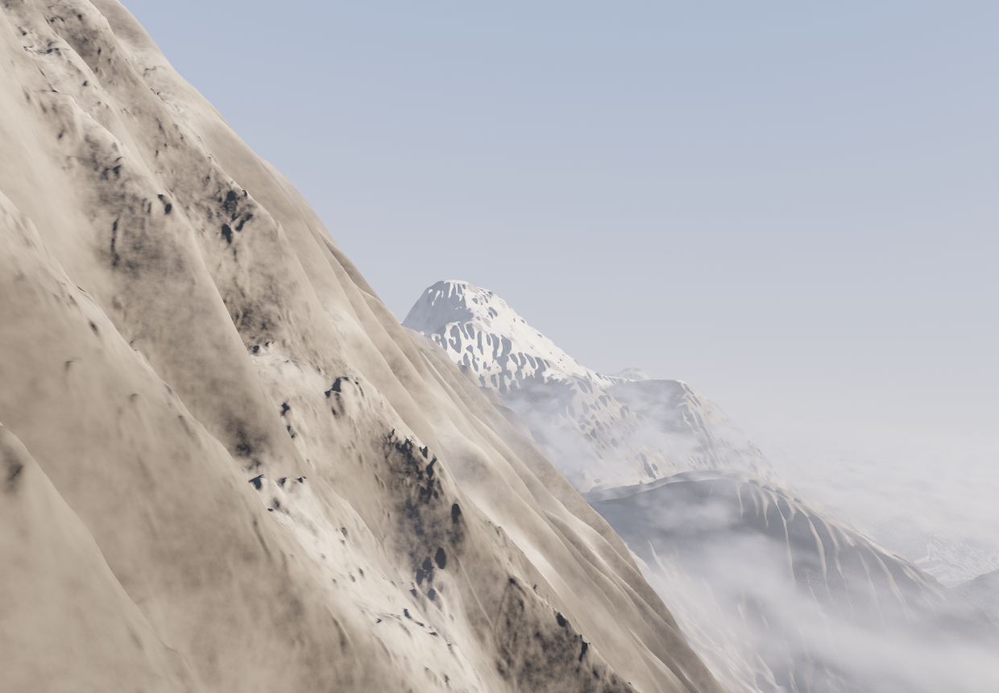
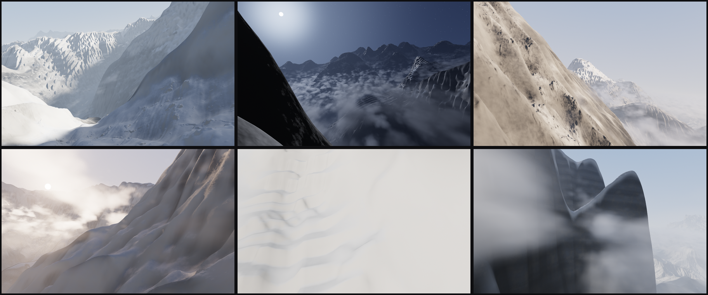
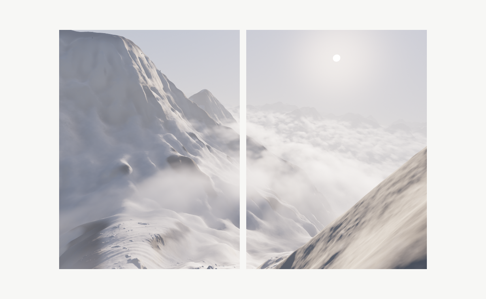

# 040 — Ridge, encounters — shaded

028's places, lit on the GPU and seen live.

**Mechanism (one sentence):** 028's engine decides everything about a seed — the place (invented
ground, or one of the surveyed ranges), where the body stands and looks, the light, the
register of the weather. Its heightfield, smoothed heightfield and materials are uploaded as
textures, and one fragment shader marches every pixel's ray over the land. It shades what
the ray meets with the sun and the sky, marches the cloud deck as a volume, and adds the air.

The same seed gives the same place, standpoint, gaze and light as 028. 028's engine is loaded
from its own folder, unchanged (028 is frozen at v1.4), and 038's loader brings in the
surveyed ranges. 028 draws its sheets with arithmetic on the CPU, in tone; this project
renders them in colour, in real time, and the body can look round and walk.

## What 028 hands over, and what the GPU does with it

| From 028 (`Compose._scene`) | On the GPU |
|---|---|
| `T.H`, 1024² heights, and `T.Hs`, the same smoothed | `RG32F` texture, sampled by hand (`texelFetch`, bilinear on the lattice as 028's `bil`) and mirrored past the edge of the grid, as 028's weather is, so a long view ends in haze and not at the edge of the survey |
| the fine ground at the feet, `T.near`: 768² cells of 1/8 unit, grown by 028 around the standpoint with stones, drifts and the trodden way | `R32F` texture. The ray steps onto it near the feet with 028's weight: full on gentle ground, none on a cliff, which it cannot hold |
| `T.rock`, `T.snow`, `T.alb`, `T.water`, `T.trk` | one `RGBA8` texture: rock, snow, albedo, water or track |
| 028's shading normal: on steep ground and under snow it comes from a smoothed height, so a wall's micro-relief does not shade as stripes | precomputed into an `RGBA8` texture, with the occlusion of the sky (how far the land rises above a point at radii 3, 10 and 30) in its alpha |
| the standpoint and gaze (`frames[k].cam`: position, yaw, pitch, roll, focal) | 028's camera exactly: a level horizon shifted by the pitch, so verticals stay vertical, and the frame rolled about its centre |
| the light: `mode` (against, side, front, overcast, moon), the sun's azimuth and elevation, direct and ambient strength, rime | the sun (or moon), its colour by elevation, the sky's colours and glow |
| the wind (`cam.wind`), the register | the cloud deck below |
| the cairns by the way | stacked stones, hit by the ray directly |

## The shader (`glsl.js`)

1. **The land.** The ray is marched over the height. Each step follows the height above the
   land, but never exceeds a fraction of the distance from the eye. A long step from high up
   went clean through a thin fin of rock and showed the land behind as a dark slot. The
   crossing is then bisected seven times. Steps: 360, 620 or 900 by quality.
2. **The surface.**
   - **Normal:** 028's normal, replaced near the eye (closer than 140 units) by the slope
     averaged over the four cells around the point. Bilinear height has one slope per cell,
     so close up every cell shaded as a flat plate.
   - **Grain:** rock carries grain finer than the survey, from 3D noise at 23, 9 and 2.3 units,
     fading with distance.
   - **Walls:** a wall (over about 50°, judged on the survey's slope as 028 judges it) is bare
     rock. It carries no snow and is textured from the side with bedding, because a
     heightfield wall is a cell or two wide and its materials would stretch down it as streaks.
   - **Snow:** it lies where 028 lays it, but slides off steep ground from about 40°.
3. **The light.**
   - Sun: a soft shadow marched over the land toward the sun (32 or 56 steps), times the
     shade of the cloud deck above, and a little light carried inside snow.
   - Sky: the sky's light from above, desaturated, times the occlusion, plus light bounced from
     the ground below.
   - Water holds the sky, with a Fresnel term.
4. **The cloud deck,** as 028 shapes it:
   - an altitude that follows the smoothed land a third of the way, set against the land
     actually in view (its mean height and spread, from a coarse cast of the view);
   - thick where the air climbs and thin in the lee (the lee factor is precomputed per seed on
     a 256² grid);
   - combed along the wind, eroded at its edges by finer billows, and drifting along 028's
     wind in real time.
   It is marched as a volume with 28, 48 or 72 steps. Each step looks 4 steps toward the
   sun, with two-lobed Henyey–Greenstein scattering and a powder term (thin edges dark against
   the light). A whiteout is not a deck but fog all round, its visibility drawn as 028 draws it
   (60–150 units).
5. **The air:** haze thickening with distance and toward the valley floor, coloured by the sky in
   the view's direction.
6. **The frame:** exposure, ACES tone mapping, gamma and a dither against banding in the sky.

**Live and still.**
- *Moving:* while anything moves (the cloud drifting, the sun turning, the body looking or
  walking), the frame is rendered at a resolution held to the frame rate (30–85 %).
- *Still:* once still, it renders at full resolution, averaged over 8 passes, each with its
  own jitter of the cloud march and of the pixel (Halton offsets). A single pass shows grain in
  the cloud and haze; 8 remove it.

The same frames in *028's two sheets* (seed 221429, Picu Urriellu, a clearing against the light; compare 028's own sheets for this seed):

## What 028 does that this does not (yet)

- **The tonal budget.** 028 solves its cloud density so the land left visible meets each
  register's budget (exposure 78 %, clearing 30 %, and so on). Here the deck's cover per
  register is set by hand (`cover` in `sketch.js`) and can be changed with *cloud cover*.
- **The tear in a clearing, the spindrift banners, the bird, the smear of movement.** 028 makes
  these in the frame, not in the world, so they have no place in a live 3D view. They are
  not drawn.
- **Walls.** A heightfield cannot overhang, and at one unit a cell a near wall is smooth in
  its large forms. Grain and bedding give it a surface, not new geometry.
- **The second gaze** ("turned", "later", "looking back") exists only in *028's two sheets*
  framing. The live view starts from the first gaze.

## Controls

| Group | Parameter (default) |
|---|---|
| Scene | register (by seed), rare event (by seed), place (by seed), framing (live view / 028's two sheets) |
| Light | turn the sun (0°), raise the sun (0°), sun moves (0° / s), exposure (0 EV) |
| Air and cloud | cloud cover (1 × the register's), deck height (0, in spreads of the land in view), cloud drift (1 × the wind), haze (1) |
| Render | quality (normal), resolution (auto: held to the frame rate) |

- **In the live view:** drag to look, shift-drag (or right-drag) or W A S D to walk, and use
  the wheel to zoom. `R` stands where 028 stood; `P` saves a PNG at full resolution,
  averaged over 8 passes.
- `?still=1` renders once at full resolution and stops (`window.DONE`), for tests and prints.
- Needs WebGL2: float textures, a 3D noise texture, `texelFetch`.

## Measured while building (test container, software WebGL)

- **Build time:** a seed builds in 6–7 s in the browser. Almost all of that is 028's own
  engine (terrain, standpoint, light, its two gazes), which this project runs unchanged. The
  textures, normals, occlusion and 64³ noise add well under a second.
- **Two fixes** found by rendering seeds of every register:
  - the dark slot from the over-long step;
  - walls white and streaked, before walls were made bare, side-textured rock.
- **Overall brightness:** the first light settings clipped snow to white. The sun is now 2.1
  and the sky's light on the land 1.5 × ambient, desaturated. In the test seeds 0–0.06 % of
  pixels are near white.
