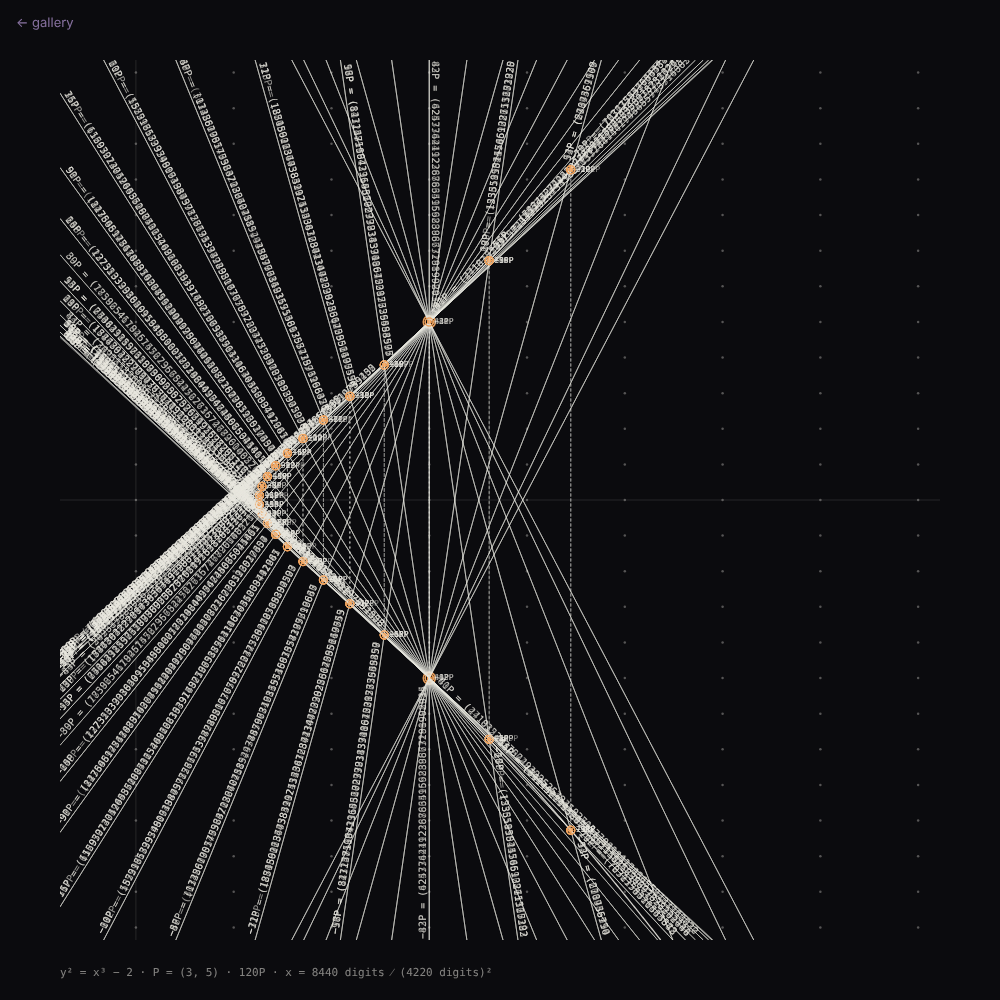
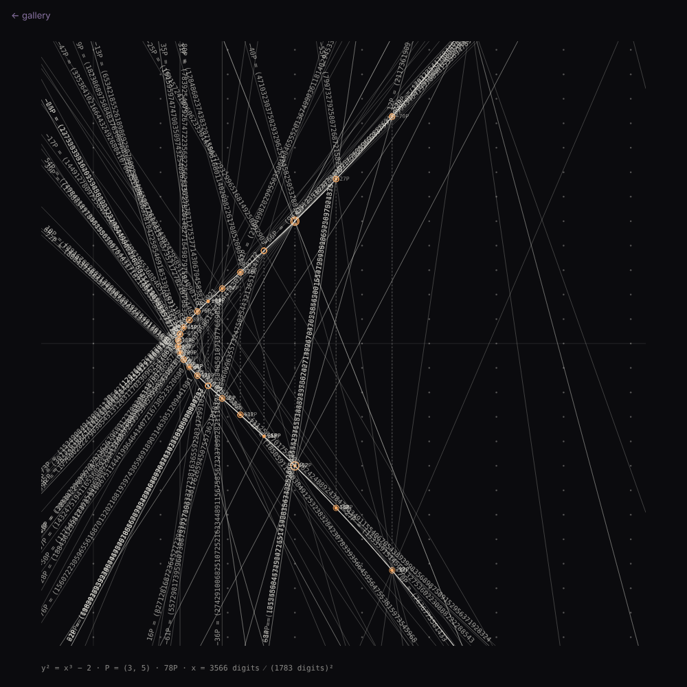

# 041 — Between a Square and a Cube

For #PCDTokyo2026 (theme: 25). 25 = 5² and 27 = 3³, and 26 is the only whole number that sits
directly between a square and a cube — Fermat's claim, Euler's proof. The same statement about
the curve y² = x³ − 2: it passes through exactly one pair of lattice points, (3, 5) and (3, −5).
The number 26 is never drawn.

**Mechanism (one sentence):** a sheet of lattice points, the curve threading between them and
touching two; from that pair, straight lines alone — a line through two points of the curve
meets it a third time, and the mirror of that third point across the axis is their sum — find
rational point after rational point, each written out exactly along the ray that found it, the
fractions outgrowing the sheet while the curve never meets another lattice point.

## The arithmetic

P = (3, 5). nP = (n − 1)P + P, so every line passes through P: the tangent at P meets the curve
again at −2P; the line through P and 2P at −3P; and so on. The mirror of the hit is the point
kept. The multiples of P are dense on the real curve (P has infinite order and the curve has one
real component), so over the run the curve fills with points, and the lines through P fill the
pencil. None of the points is a lattice point.

Every coordinate is exact: nP = (A/d², B/d³) with A, B, d whole numbers in lowest terms,
computed with BigInt through the division polynomials ψ_n at P (ψ_2 = 10, ψ_3 = 171,
ψ_4 = −7660, …):

- x(nP) = 3 − ψ_{n−1} ψ_{n+1} / ψ_n², y(nP) = (ψ_{n+2} ψ_{n−1}² − ψ_{n−2} ψ_{n+1}²) / (20 ψ_n³)
- d_n = |ψ_n|; no gcd is taken, and the fractions were checked reduced against exact rational
  arithmetic for n ≤ 300.

| n | d_n (digits) | x(nP) numerator (digits) |
|---|---|---|
| 2 | 10 (2) | 129 (3) |
| 3 | 171 (3) | 164323 (6) |
| 10 | 30 | 59 |
| 40 | 469 | 938 |
| 120 | 4220 | 8440 |
| 300 | 26375 | 52750 |

The digits grow as n² (the canonical height), so a label of ten thousand characters is cut by
the frame after a couple of hundred: the spill is the drawing. Positions on the sheet are floats
taken from the exact values; the digits written along a ray are the exact point.

## The sheet

- A square sheet (or 7:5, or 4:5) scaled to fit any screen, so the work does not depend on
  screen size. The frame is a window onto the plane, x from −1.5 to 7.5 and y within ±13 by
  default, with the lattice as dots and the two lattice points on the curve ringed.
- One step: the ray grows from P across the frame; the third point is ringed; a dotted vertical
  drops to its mirror, the point kept, named beside it; the fraction is typed along the ray,
  outward from the hit, until the frame cuts it. A hit outside the frame is a bare ray, drawn at
  half the time.
- Pass 1 runs n = 2 … reach through (3, 5); pass 2 runs the mirror through (3, −5), so the
  finished sheet is symmetric about the axis. It then rests, fades, and begins again. At the
  default tempo (8 s per step, reach 120) a full drawing takes about 25 minutes.
- **web** construction: the seed picks chords between any two points already found (weighted
  toward the small multiples), so the lines no longer all pass through P and the pencil becomes
  a web. The same arithmetic; the points are the same multiples of P in a different order.

The seed nudges the window a little, so two seeds are two framings of the same construction;
in the web construction it also decides the chords.

## Controls

Panel: construction (star / web), reach, passes, seconds per step, rest; the frame (x range,
±y, sheet, ground: light on dark or ink on paper); marks (which fractions are written, digit
size, ray strength, lattice, caption). Keys: **R** new seed · **S** save PNG (the sheet at 2×)
· **V** save SVG (lines, dots and the text as `<text>`) · **space** pause · **→** next step now.
`?still=1` draws every step at once.

## Posting on neort.io

`neort.html` is the whole piece in one file — `mordell.js` inlined, no harness, no panel, no
CDN — built by `tools/neort-bundle.sh`. It takes its settings from the query string
(`?seed=7&tempo=8&reach=120&ground=paper&mode=web`). Post it with the tag `PCDTokyo2026`.

**Posted:** https://neort.io/ja/art/dbbnmqml0as1gac24mc0 (20 October 2026, tags `PCDTokyo2026`,
`NEORTchallenge`; listed on the challenge page).

### The post

**Title:** Between a Square and a Cube — y² = x³ − 2

**Description (EN):**

> 25 = 5². 27 = 3³. 26 is the only whole number that sits directly between a square and a
> cube — Fermat claimed it, Euler proved it. Said about a curve: y² = x³ − 2 passes through
> exactly one pair of lattice points, (3, 5) and (3, −5).
>
> Start there. A line through two points of the curve meets it a third time; mirror that third
> point across the axis and you have their sum. The tangent at (3, 5) finds 2P; the line through
> P and 2P finds 3P; and so on — every line through the one lattice point the curve holds. The
> points are dense on the curve, their coordinates exact fractions whose digits grow with n²:
> 2P = (129/10², −383/10³); 120P has a 4,220-digit denominator. Each fraction is typed along the
> ray that found it until the frame cuts it off. The curve never meets another lattice point.
> The number 26 is never drawn.
>
> Exact arithmetic (BigInt, division polynomials at P); one pass through (3, 5), then the mirror
> pass through (3, −5); the sheet rests, fades, and begins again. A fixed sheet, scaled to any
> screen.
>
> Keys: space pause · → next step. URL options: ?seed=… &tempo=8 &reach=120 &ground=paper
> &mode=web

**Description (JA):**

> 25 = 5²、27 = 3³。26 は、平方数と立方数のちょうど間にある唯一の整数です──フェルマーが主張し、
> オイラーが証明しました。曲線で言えば、y² = x³ − 2 が通る格子点はただ一組、(3, 5) と (3, −5)
> だけです。
>
> そこから始めます。曲線上の2点を結ぶ直線は曲線と3つ目の点で交わり、その点をx軸で折り返した
> ものが2点の「和」です。(3, 5) での接線が 2P を、P と 2P を通る直線が 3P を見つけ、以下同様に
> ──すべての直線が、曲線上のただ一つの格子点を通ります。点は曲線上に稠密に増え、その座標は n²
> に比例して桁数が増える正確な分数です。2P = (129/10², −383/10³)、120P の分母は 4,220 桁。各分数
> は、それを見つけた直線に沿って、画面の端に切られるまで書き出されます。曲線は他の格子点には
> 決して触れません。26 という数は一度も描かれません。
>
> 厳密な計算(BigInt、P における分割多項式)。(3, 5) を通る一巡、次に (3, −5) を通る鏡像の一巡。
> 描き終えると休み、消え、また始まります。画面サイズに依存しない固定の紙面。
>
> キー:スペース 一時停止 · → 次の一手。URL オプション:?seed=… &tempo=8 &reach=120
> &ground=paper &mode=web

**Tags:** `PCDTokyo2026`, `25`, `elliptic curve`, `number theory`, `generative`

Files: `mordell.js` (the piece, harness-free), `sketch.js` (panel, keys, exports),
`index.html`, `neort.html` (generated), `preview.png`, `web.png`.
