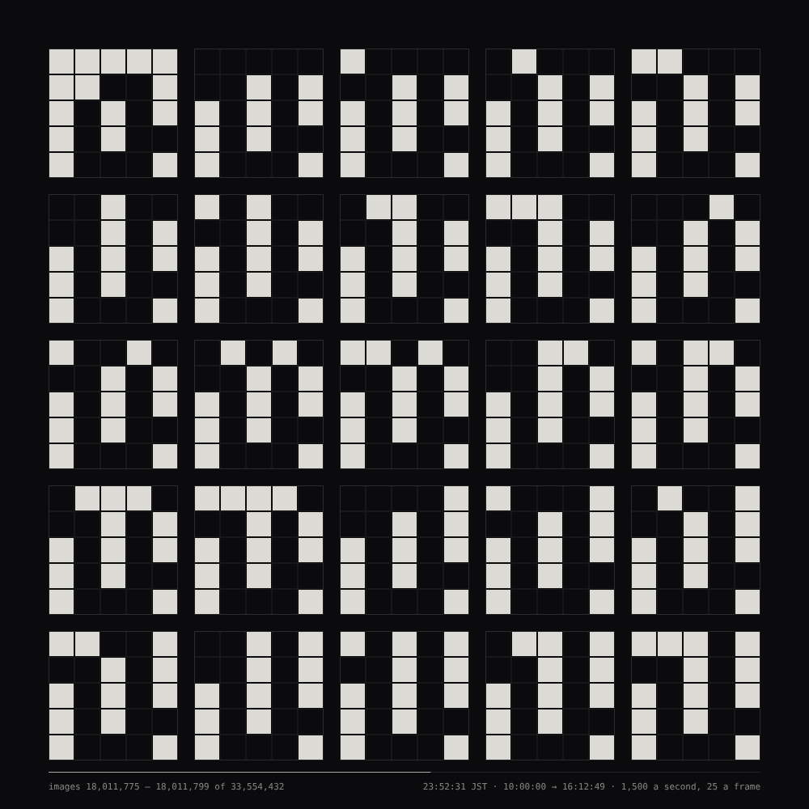
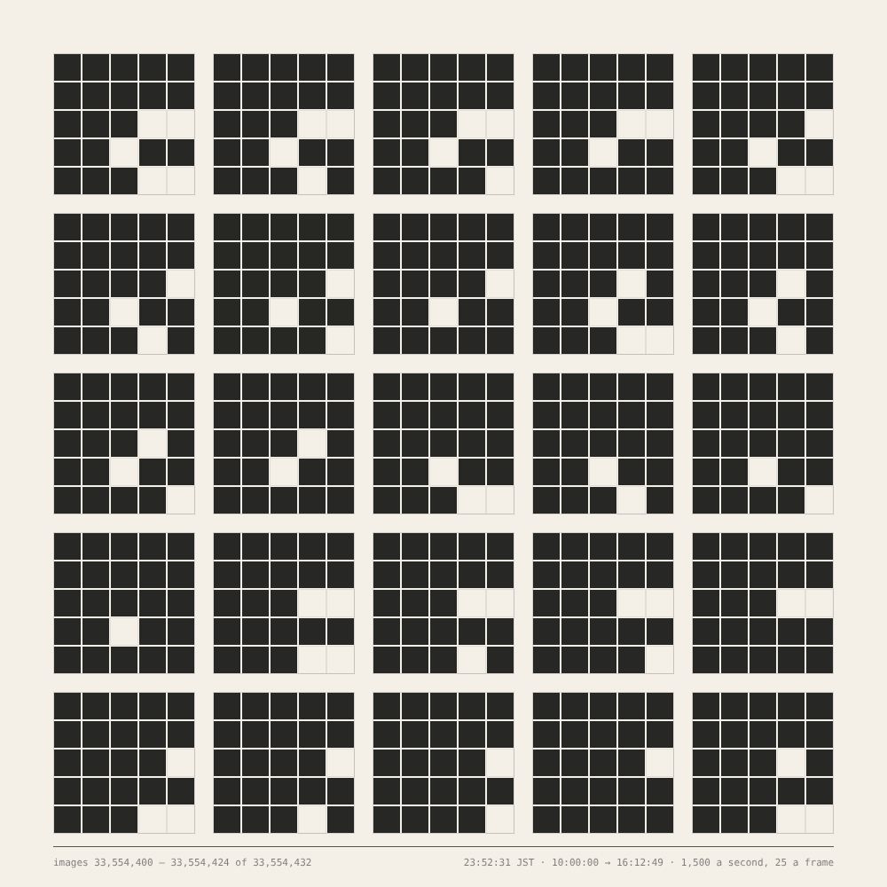

# 042 — Every 25-Pixel Image, Exhausted in One Day

For #PCDTokyo2026 (theme: 25). A 5 × 5 grid of cells, each on or off, can show
2²⁵ = 33,554,432 images. Twenty-five of them are shown on every frame, as a sheet of 5 × 5
tiles; at 60 frames a second that is 1,500 images a second, and every image has been shown
after **6 h 12 m 49.6 s** — the length of one exhibition day. The sheet is locked to Tokyo
time: it begins at 10:00:00 JST, finishes at 16:12:49 JST, and rests on the last 25 images.

**Mechanism (one sentence):** the images are counted in binary — cell c of an image is on when
bit c of its number is set, bits numbered row by row from the top left — so the top-left cell
changes every image, the next cell every second image, and the bottom-right cell once, three
hours in; each row of a tile is a clock five bits wide, the first row a blur, the last row
barely moving.

After John F. Simon Jr.'s *Every Icon* (1997), which counts through every image of a 32 × 32
grid at 100 a second: its first row alone takes about 1.36 years, the whole grid longer than
the universe has existed. Twenty-five cells, and twenty-five at a time, bring the same
enumeration inside one day. (Counting rotations and reflections as the same image, there are
4,211,744 distinct ones; the sheet shows them all, each of them up to eight times.)

| row of a tile | bits | the first cell of the row changes every |
|---|---|---|
| 1 | 0–4 | image (within one frame's 25) |
| 2 | 5–9 | 21 ms |
| 3 | 10–14 | 0.68 s |
| 4 | 15–19 | 21.8 s |
| 5 | 20–24 | 11 m 39 s · the last cell: 3 h 6 m |

## The clock

The position comes from the clock, not from the frame count: at time t the sheet shows the
block of 25 images beginning at 25 · ⌊1500 t / 25⌋, where t is the time since 10:00:00 JST.
So the sheet is correct whenever it is shown, at whatever time a rotation brings it up, and
two screens showing it agree. Before 10:00 it shows image 0 (every cell off) and the time
until it begins; after 16:12:49 it rests on the last block, nearly solid, and says that every
image has been shown. Japan keeps no summer time, so the offset is a constant +9 h. A display
slower than 60 frames a second shows fewer of the images, never out of order.

**from load** runs the same day from the moment the page opens, rests, and begins again — for
the gallery, where a visitor should not meet a finished sheet.

## Controls

Panel: clock (Tokyo time / from load), the hour it begins (JST), images a second, the rest;
which cell holds which bit (row by row, or shuffled by the seed — the same enumeration laid
out differently, exhausted in the same time), ground (light on dark / ink on paper), caption.
Keys: **R** new seed · **S** save PNG (the sheet at 2×). `?at=<image>` shows the block holding
that image and stops.

## Posting on neort.io

`neort.html` is the whole piece in one file — `icons.js` and `neort-boot.js` inlined, no
harness, no panel, no CDN — built by `tools/neort-bundle.sh 042-every-25-pixel-image
"Every 25-Pixel Image, Exhausted in One Day" icons.js`. It runs on Tokyo time by default; the
query string overrides (`?clock=load`, `?start=14:00`, `?rate=3000`, `?ground=paper`,
`?order=seed&seed=7`, `?at=20000000`). Post it with the tag `PCDTokyo2026`.

### The post

**Title:** Every 25-Pixel Image, Exhausted in One Day

**Description (EN):**

> A grid of 5 × 5 cells, each on or off, can show 33,554,432 images — 2²⁵. This sheet shows
> 25 of them on every frame and counts through all of them in binary, 1,500 a second: the
> top-left cell changes every image, the bottom-right once, three hours in. Every image has
> been shown after 6 hours 12 minutes 49 seconds — one exhibition day. The sheet is locked to
> Tokyo time: it begins at 10:00:00 JST, finishes at 16:12:49 JST, and rests on the last 25
> images. After John F. Simon Jr.'s Every Icon (1997), whose 32 × 32 grid would take longer
> than the age of the universe.

**Description (JA):**

> 5 × 5 のマス目、各マスはオンかオフ。その画像は全部で 33,554,432 枚、2²⁵ 枚あります。この
> 紙面は毎フレーム 25 枚を映し、二進法で数え上げます。毎秒 1,500 枚。左上のマスは 1 枚ごとに
> 変わり、右下のマスは 3 時間後に一度だけ変わります。6 時間 12 分 49 秒で、すべての画像が
> 一度ずつ映し出されます──展示の一日です。紙面は東京の時刻に固定されています。10:00:00 JST
> に始まり、16:12:49 JST に終わり、最後の 25 枚で静止します。ジョン・F・サイモン・Jr. の
> Every Icon(1997)に倣って──あの 32 × 32 のマス目では、宇宙の年齢より長くかかります。

**Tags:** `PCDTokyo2026`, `25`, `every icon`, `enumeration`, `clock`

Files: `icons.js` (the piece, harness-free), `sketch.js` (panel, keys, export), `index.html`,
`neort-boot.js`, `neort.html` (generated), `preview.png`, `end-paper.png`.
