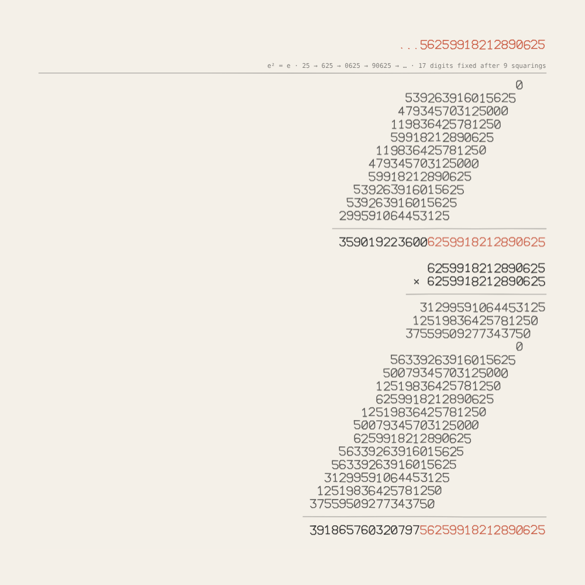
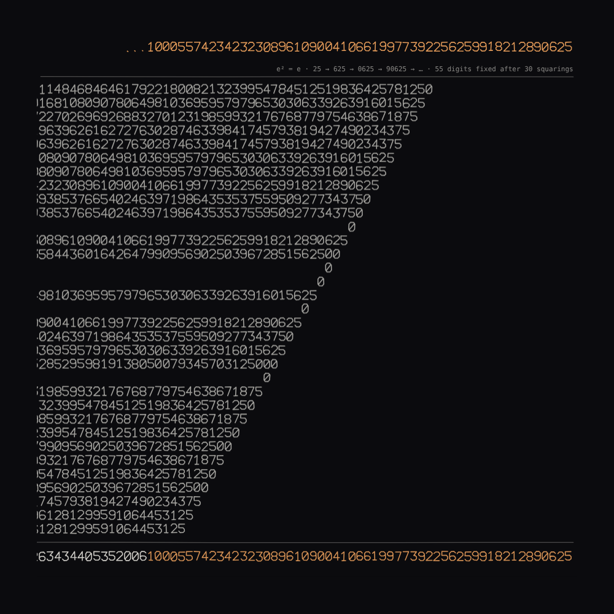

# 043 — …8212890625

For #PCDTokyo2026 (theme: 25). 25² = 625. 625² = 390625. 90625² = 8212890625. Each square
keeps the ending of the number it came from, and the endings grow: 25, 0625, 90625,
8212890625, 18212890625, … The process converges — not to any whole number, but to a number
with infinitely many digits to the left, …896109004106619977392256259918212890625, that is
its own square. Every squaring is written out as hand-written long multiplication on a till
roll; the receipt gets longer forever, and its right-hand end never changes again.

**Mechanism (one sentence):** square the fixed digits, write the multiplication out in full,
mark the digits of the result that will never change again, carry them down, and square
those — a till roll printed from the foot up, right-aligned, the rows growing leftward past
the edge of the paper as the number grows, with the number itself at the head of the roll.

## The arithmetic

The 10-adic integers are numbers with digits running infinitely far to the left, added and
multiplied digit by digit with carries, as on paper. Among them are two that are their own
square besides 0 and 1: …8212890625 and …7109376. They are one apart (they sum to 1), and
each is 0 in one of the two "halves" of the 10-adic numbers and 1 in the other — 10 = 2 · 5,
and a 10-adic number is a 2-adic number and a 5-adic number side by side. …890625 is 1 on the
2-adic side and 0 on the 5-adic side.

That is why squaring alone finds it. Squaring a multiple of 5ᵏ gives a multiple of 5²ᵏ: the
5-adic side doubles its agreement at every step. Squaring a number that is 1 mod 2ʲ gives one
that is 1 mod 2ʲ⁺¹ (because (1 + 2ʲt)² = 1 + 2ʲ⁺¹t + 2²ʲt²): the 2-adic side gains at least
one place. So every squaring fixes at least one more digit, and the digits that agree are
exactly min(v₅(y), v₂(y − 1)) of them — the piece computes that, it does not guess. The
other idempotent cannot be reached this way: seeded by 6, squaring gives 36, whose 5-adic
agreement with …109376 is stuck at one digit, so 6 → 36 → 6 → 36 forever. 25 is the seed
that works.

| squaring | x | x² | digits fixed |
|---|---|---|---|
| 1 | 25 | 625 | 4 · 0625 |
| 2 | 0625 | 390625 | 5 · 90625 |
| 3 | 90625 | 8212890625 | 10 |
| 4 | 8212890625 | 67451572418212890625 | 11 |
| 5 | 18212890625 | 331709384918212890625 | 12 |
| 10 | 2259918212890625 | … | 20 |
| 30 | … | … | 55 |
| 60 | … | … | 115 |

The gain is irregular — 1, 1, 5, 1, 1, 1, 1, 2, 1, 2 … — because the 2-adic side is
sometimes luckier than its guaranteed one place (90625 − 1 = 2⁹ · 177, so 90625² is right to
ten digits at once).

## The receipt

- Each squaring is one block: the multiplicand, "× " the multiplier, a rule, one partial
  product per digit of the multiplier (from the right, each shifted one place further left;
  a zero digit gives a lone 0), a rule, the result with its fixed digits in the accent, a
  blank row. The fixed digits are the next block's multiplicand — with a leading zero when
  the arithmetic says so (625 → 0625).
- Rows appear one at a time (0.4 s each; a pause of 1.6 s between squarings), and the roll
  glides up to meet each one. The receipt is right-aligned: the rows grow leftward and run
  off the edge of the paper. The number so far stands at the head of the roll in the accent,
  with how many digits are fixed after how many squarings.
- The digits are single-stroke glyphs (`assets/strokefont.js`, the gallery's plotter font),
  each leaning and wobbling as the seed says — the seed is the hand, nothing else; the
  arithmetic is the same for every seed. `hand` 0 is ruled type, 1 a hurried hand.
- Pace: the roll's blocks grow with the number — a block has k + 5 rows for a k-digit
  multiplicand — so the receipt slows as the number grows, as it should. In the first minute
  it reaches about 8 squarings and 16 fixed digits; after an hour, around 70 squarings and
  130 digits, the rows far wider than the paper.

## Controls

Panel: seconds per row, the pause between squarings; digit height, the hand, ground (ink on
paper / light on dark), the number at the head. Keys: **R** a new hand · **S** save PNG (the
sheet at 2×). `?at=<n>` shows the roll after n squarings and stops.

## Posting on neort.io

`neort.html` is the whole piece in one file — the stroke font, `receipt.js` and
`neort-boot.js` inlined, no harness, no panel, no CDN — built by
`BG="#f4f0e8" tools/neort-bundle.sh 043-8212890625 "…8212890625" ../../assets/strokefont.js receipt.js`.
The query string overrides (`?beat=0.25`, `?pause=1`, `?size=16`, `?hand=1`, `?ground=dark`,
`?seed=7`, `?at=20`). Post it with the tag `PCDTokyo2026`.

### The post

**Title:** …8212890625

**Description (EN):**

> 25² = 625. 625² = 390625. 90625² = 8212890625. Each square keeps the ending of the number
> it came from, and the endings grow. The process converges — not to any whole number, but to
> a number with infinitely many digits to the left, …896109004106619977392256259918212890625,
> that is its own square: one of the two 10-adic numbers that are, and the only one squaring
> can reach, with 25 as its seed. Every squaring is written out as hand-written long
> multiplication on a till roll: the receipt gets longer forever, and its right-hand end
> never changes again.

**Description (JA):**

> 25² = 625。625² = 390625。90625² = 8212890625。二乗するたびに、元の数の末尾がそのまま残り、
> 残る桁が増えていきます。この過程は収束します──ただの整数にではなく、左に無限に桁が続く数
> …896109004106619977392256259918212890625 に。自分の二乗が自分に等しい数です。10 進
> p 進数(10-adic)でそうなる数は二つあり、二乗だけでたどり着けるのはこちらだけ。種は 25 です。
> 二乗のたびに、手書きの筆算をレシートに打ち出します。レシートは永遠に伸び続け、右端は二度と
> 変わりません。

**Tags:** `PCDTokyo2026`, `25`, `10-adic`, `long multiplication`, `receipt`

Files: `receipt.js` (the piece, harness-free, needs `assets/strokefont.js`), `sketch.js`
(panel, keys, export), `index.html`, `neort-boot.js`, `neort.html` (generated),
`preview.png`, `dark-30.png`.
