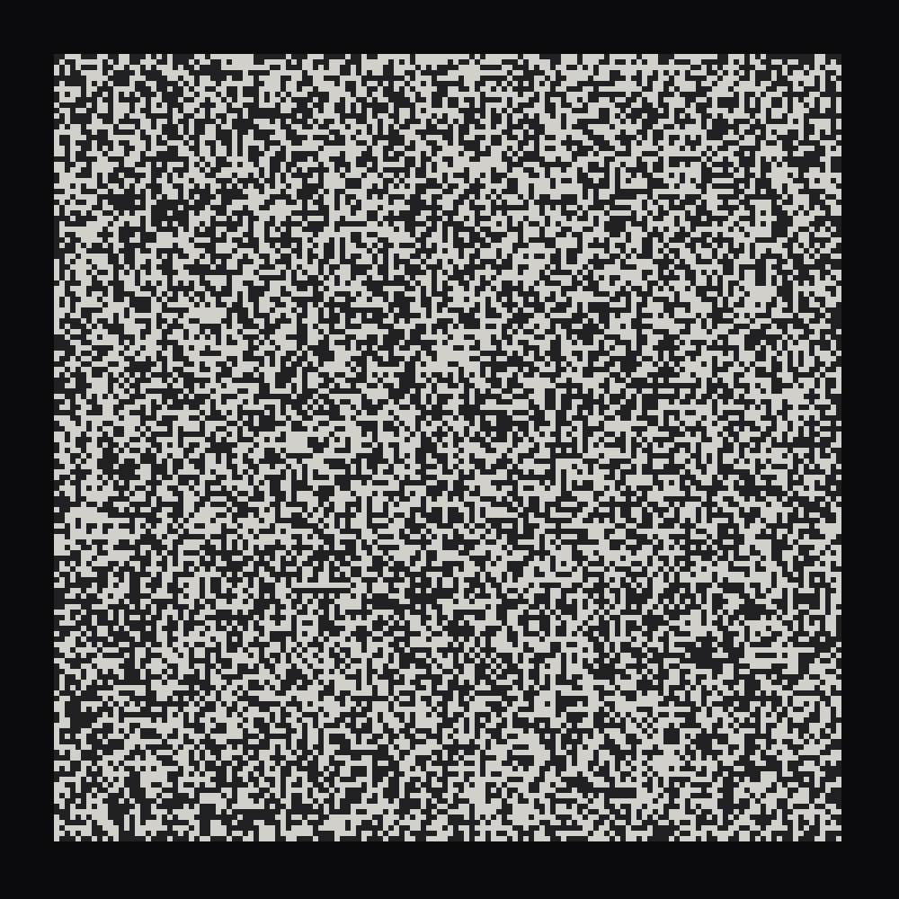
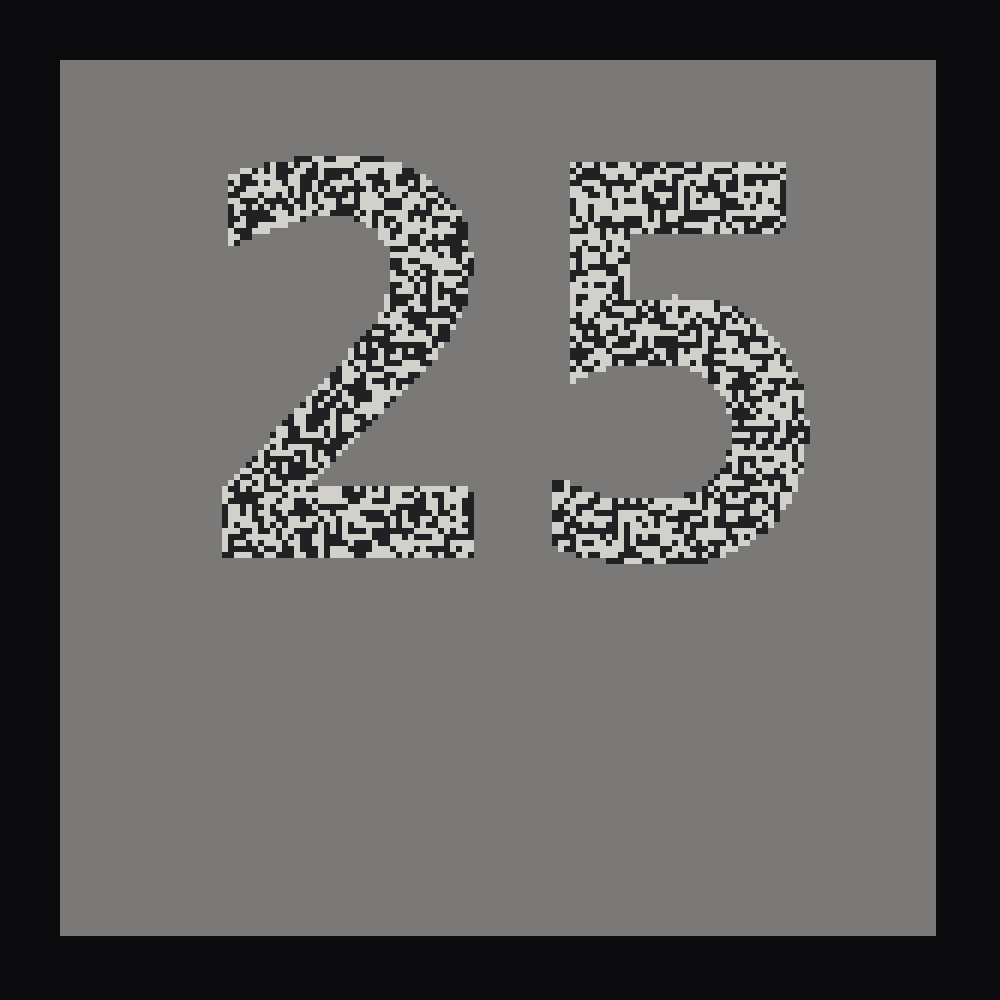
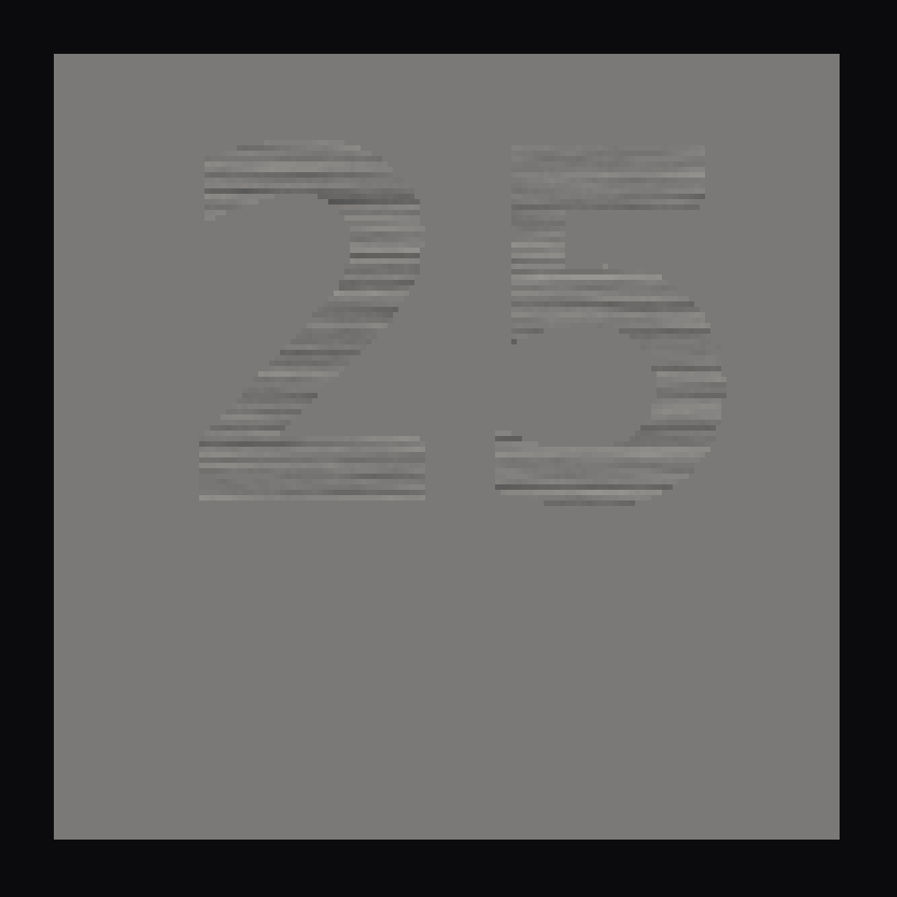

# 044 — The 25th Frame

For #PCDTokyo2026 (theme: 25). The Soviet "25th frame": a frame slipped into film running at
24 a second, too brief to be seen, said to work on the viewer all the same. The myth has it
the other way round. Here the number 25 is never in any frame at all. Every frame is fair-coin
noise, and from one frame alone nothing about the figure can be read. The figure is in the
relation between frames: it appears to the eye, through persistence of vision, and to a
camera on a long exposure — and to nothing that looks at a single frame.

**Mechanism (one sentence):** every cell of the field is black or white on a toss; outside the
figure every cell flips to its opposite on each frame, so any two frames cancel to flat grey,
and inside the figure the noise holds still (or drifts one cell a frame) — so the still region
stands in the shimmering field for the eye, and frozen noise stands in grey for a camera,
while each frame on its own is noise.

## Why no single frame holds it

A frame is a field of cells, each independently black or white with probability ½. That is
true whether a cell is inside the figure or outside it, on every frame: inside, a cell keeps
the toss it had; outside, it takes the opposite of the toss it had — and the opposite of a fair
toss is a fair toss. So the distribution of any one frame is the same with the figure as
without it. The figure is carried entirely by the correlation between consecutive frames:
+1 inside (the same), −1 outside (the opposite). No single image has it; any two do.

- **Two frames** averaged: outside, black + white = grey, exactly; inside, the held toss stays
  black or white. The figure appears as full-contrast noise texture on flat grey. A phone
  exposure of 1/30 s at a 60 Hz screen is two frames.
- **The eye:** the field outside flickers at half the frame rate, which fuses to a shimmer;
  the region inside holds still. The visual system segments by temporal change as readily as
  by luminance, and the still region reads as a figure at once.
- **drift:** inside the figure the noise slides one cell to the right per frame instead of
  holding. A single frame is still fair-coin noise; the eye sees a moving region; a long
  exposure shows horizontal streaks in the shape of the figure.

The figure comes and goes in takes — present for 4 s, absent for 2.5 s with the whole field
flickering — and sits where the seed puts it each time, so a viewer who arrives mid-gap sees
only noise until the next take.

## Controls

Panel: inside the figure the noise holds or drifts; take and gap; the figure's height; placed
where the seed puts it or centred; cell size; ground; contrast of the noise (1 is full black
and white; 0.8 by default, a courtesy to the eye — the cancellation is exact at any contrast);
long exposure (0 live, or the mean of n frames, a still); caption. Keys: **R** new seed ·
**S** save PNG (one frame, or the exposure). `?expose=<n>` from the URL shows the mean of n
frames of a take and stops.

A note on flicker: the field alternates fine high-contrast noise at half the display's rate.
Its mean luminance is constant (half the cells are lit on every frame), so it does not flash,
but it is a strong pattern stimulus; the contrast control is there for that.

## Posting on neort.io

`neort.html` is the whole piece in one file — `frame25.js` and `neort-boot.js` inlined, no
harness, no panel, no CDN — built by `tools/neort-bundle.sh 044-the-25th-frame "The 25th
Frame" frame25.js`. The query string overrides (`?figure=drift`, `?take=6&gap=2`, `?cell=8`,
`?contrast=1`, `?ground=paper`, `?expose=60`, `?seed=7`). Post it with the tag `PCDTokyo2026`.

### The post

**Title:** The 25th Frame

**Description (EN):**

> The Soviet "25th frame": a frame slipped into film, too brief to be seen, said to work on
> the viewer all the same. Here it is the other way round. The number 25 is never in any frame.
> Every frame is fair-coin noise, and from one frame alone nothing can be read. Outside the
> figure every cell flips to its opposite on each frame, so any two frames cancel to flat
> grey; inside it the noise holds still. The figure exists only in time — for the eye, through
> persistence of vision, and for a camera on a long exposure of two frames or more. Pause it,
> screenshot it, look at any one frame, and it is gone.

**Description (JA):**

> ソ連の「25 フレーム目」──フィルムに紛れ込ませた、見えないはずの一コマが観客に働きかける、
> という伝説。ここではその逆です。25 という数は、どのフレームにも存在しません。すべてのフレー
> ムはコイン投げのノイズで、一枚だけからは何も読み取れません。図形の外側では各マスが毎フレーム
> 反転し、どの二枚を重ねても平らな灰色に打ち消し合います。内側ではノイズが静止しています。
> 図形は時間の中にだけあります──目には残像として、カメラには二フレーム以上の長時間露光として。
> 一時停止しても、スクリーンショットを撮っても、一枚を見れば、消えています。

**Tags:** `PCDTokyo2026`, `25`, `persistence of vision`, `noise`, `subliminal`

Files: `frame25.js` (the piece, harness-free), `sketch.js` (panel, keys, export),
`index.html`, `neort-boot.js`, `neort.html` (generated), `frame.png`, `preview.png`,
`drift.png`.
