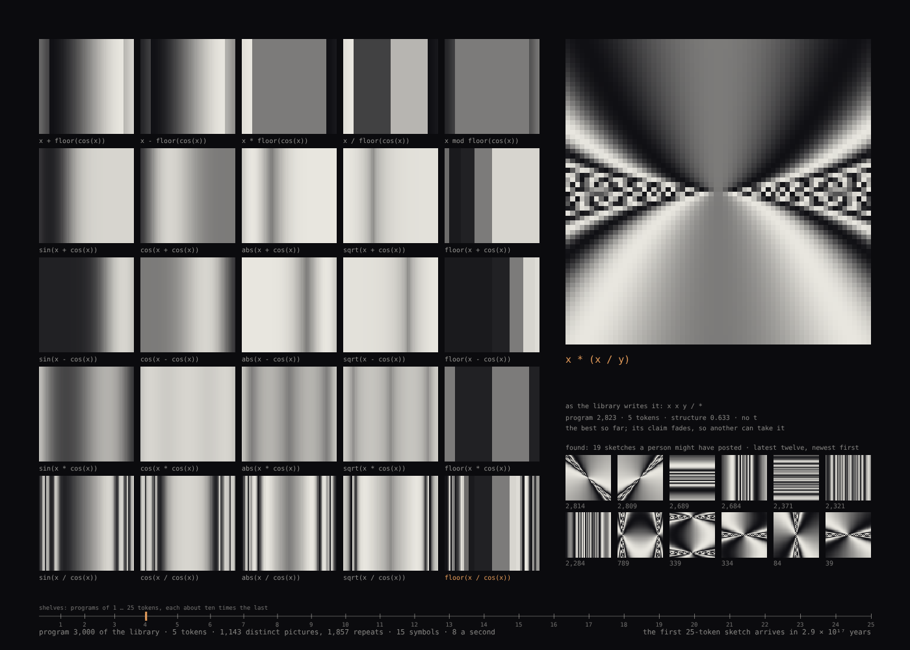
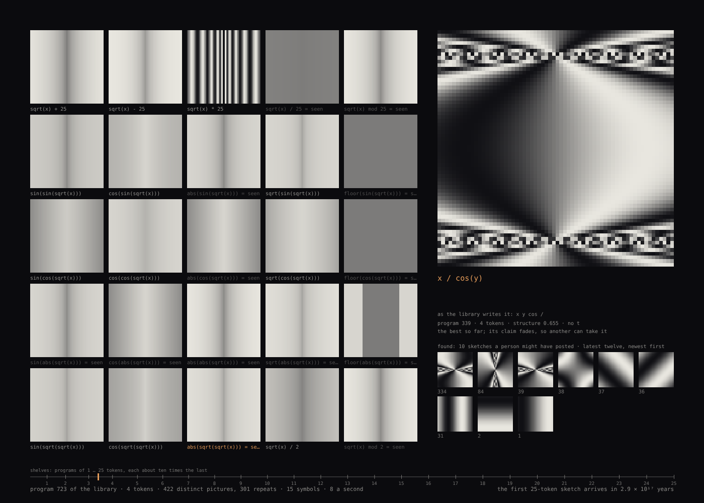
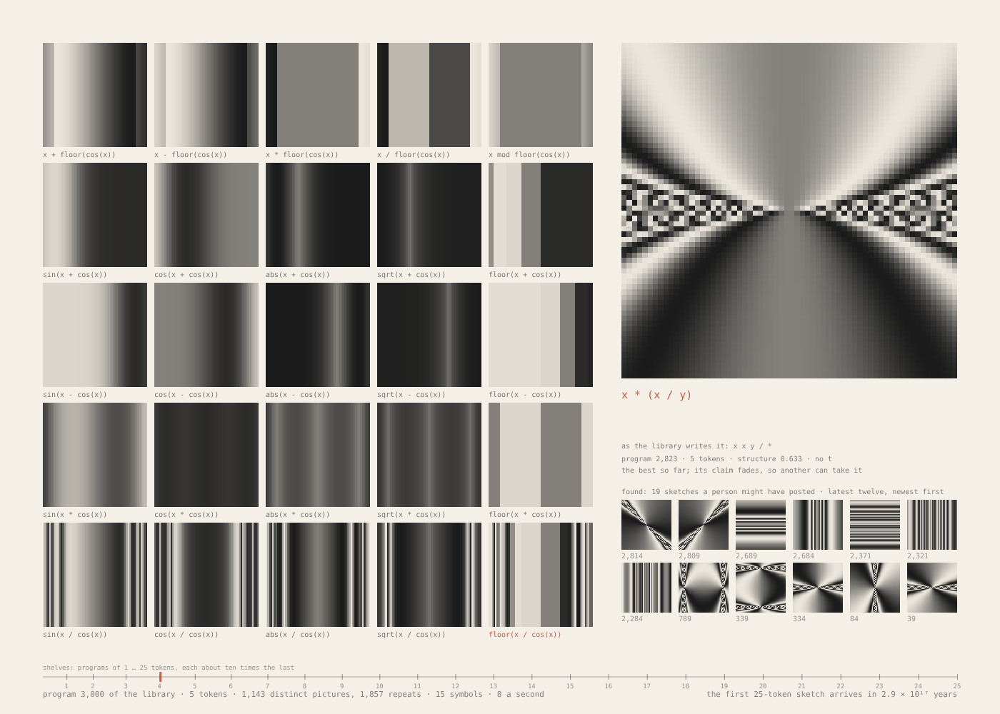

# 045 — Every 25-Token Sketch

For #PCDTokyo2026 (theme: 25). つぶやきProcessing — "tweet Processing" — is a Tokyo-born
practice: a whole sketch in the 280 characters of one post. Most short programs draw little;
the ones worth keeping were found by people, one at a time. This piece enumerates instead,
and selects by a stated preference: every program of a tiny pixel language, one to
twenty-five tokens, in order, shortest first, drawn as it arrives — a Library of Babel of
sketches, read from the first shelf — with a selector that holds one picture longer.

**Lineage.** John F. Simon Jr.'s *Every Icon* (1997) enumerates every 32 × 32 image and will
not finish; this enumerates programs, so many entries draw the same picture, and adds a
selector. Karl Sims's expression-generated images (1991) drew pictures from formulas by
mutation and human choice; here the order is exhaustive and the choice is a measured rule.

**Mechanism (one sentence):** fifteen symbols, written postfix so that every well-formed string
of them is a program; the programs of each length (one to twenty-five tokens) are counted by a
recurrence on stack depth and the k-th is unranked from that table, so the order is exact and
the same for everyone;
each program is drawn as a 64 × 64 field (a sketch is short) at 8 a second onto a conveyor of
25 tiles with its code beneath, while a slow lane keeps the program that scores best for
having structure, and lets its claim fade so another can take it; every dethroned champion
drops into a column of the found, every picture is hashed so the sheet counts distinct
pictures and a picture already seen cannot take the lane, and a ruler places the current
program in the whole library on a log scale.

## The language

| leaves | unary | binary |
|---|---|---|
| `x` `y` `t` `2` `25` | `sin` `cos` `abs` `sqrt` `floor` | `+` `−` `×` `÷` `mod` |

A pixel at (x, y) ∈ [−2, 2]², at time t in seconds, takes the value of the program; the tone
shown is ½ + ½ sin(value). Division by zero gives ±10⁹, `sqrt` takes the absolute value,
`mod` is floored. Programs are written postfix (`x y * sin`) and shown infix (`sin(x * y)`).

| tokens | programs | cumulative |
|---|---|---|
| 1 | 5 | 5 |
| 2 | 25 | 30 |
| 3 | 250 | 280 |
| 4 | 2,500 | 2,780 |
| 5 | 28,125 | 30,905 |
| 6 | 328,125 | 359,030 |
| 7 | 3,984,375 | 4,343,405 |
| 25 | 951,507,031,023,502,349,853,515,625 | 1,023,989,447,130,247,699,415,280,905 |

At 8 a second, an exhibition day (6 h 15 m) reaches program 180,000, the sixth token. The
first 25-token program — `x + x + x + x + x + x + x + x + x + x + x + x + x` — is number
72,482,416,106,745,349,561,765,281 and arrives in 2.9 × 10¹⁷ years. The sketch does not stop.

The count is a recurrence on stack depth: with r tokens left and d values on the stack, the
completions are 5·w(r−1, d+1) + 5·w(r−1, d) [if d ≥ 1] + 5·w(r−1, d−1) [if d ≥ 2], ending at
depth 1. The same table unranks: for the k-th program of its length, each position takes the
first symbol in alphabet order whose completions number more than what remains of k. All of it
is BigInt, so the order is exact for every length the library holds. The running index is a
JavaScript number, exact to 2⁵³ ≈ 9 × 10¹⁵ programs — 3.6 × 10⁷ years at 8 a second — which
is where this implementation, not the library, ends.

## The slow lane

The selector is an authored preference, measured rather than judged by eye: the tonal entropy
of the 64 × 64 field (0 flat … 1 every tone), times a preference for a middle amount of edge,
exp(−((g − 0.13) / 0.09)²), an e-folding half-width of 0.09 (σ ≈ 0.064). Measured on typical
programs, a plain gradient has mean edge 0.01, bands and fans 0.1–0.2, moiré and noise 0.35
and up; the preference peaks at 0.13, so bands, fans and rings win, gradients and noise lose.
The lane holds the incumbent against each new, unrepeated program; it is not necessarily the
best-scoring program seen, since its score fades. A picture
that varies along one axis only — a function of x alone, which is most of the early library —
scores half, measured as the smaller of its horizontal and vertical variation being under a
twentieth of the larger; without this rule every champion is stripes. The champion's score
fades by 0.9992 per program, so a later, only slightly worse program takes the lane within a
few minutes.

## What the sheet shows, besides the conveyor

- **The found.** When the slow lane changes hands the outgoing champion is printed as it stood
  at that moment and drops into a column beneath the lane, with its program number — the
  sketches a person might have posted. The latest twelve are shown, newest first; all are
  counted. Prints, not live fields: the found do not move, and cost nothing a frame.
- **Distinct pictures.** Many programs draw the same picture: `x + y` and `y + x`,
  `sin(floor(25))` and `sin(abs(25))`, anything that reduces to a constant. Each picture is
  fingerprinted from its tones at t = 0 and t = 1 (16 levels) and hashed to 64 bits (two FNV-1a
  lanes); the caption counts distinct pictures and repeats, a repeat's code is dimmed and marked
  `= seen`, and a repeat cannot take the lane. The fingerprint is two instants, so two
  programs that agree at t = 0 and t = 1 and differ between count as one picture — an
  approximation, stated. A 32-bit hash collided within the first 10,075 programs
  (`floor(y mod 2)` and `floor(sqrt(y + t))`, 4,096 of 8,192 values apart); at 64 bits a
  collision among a day's 187,000 programs has probability of order 10⁻⁹. The library is
  mostly repetition: through the fifth shelf, three programs in four draw a picture already
  drawn.
- **The ruler.** A line along the foot is the whole library on a log scale, a tick per shelf
  (programs of 1 … 25 tokens, each about ten times the last), the cursor at the program now.
  The cursor sits at the far left all day.
- **The prologue.** The first 280 programs — the characters of a post — pass at one every
  1/60 s, under five seconds, so the one- and two-token shelves (constants and gradients) are
  over before the viewer has settled; then 8 a second. Arrivals are scheduled on the clock and
  each is evaluated at its own scheduled time, so a slow frame rate changes only smoothness;
  at most 200 arrivals are processed in one frame, the rest follow. A still (`?at=n`) replays
  the same schedule, so it is the live state after n arrivals.
- **Time.** A program containing `t` carries an accent mark at the right end of its code, and
  the champion's caption reads "uses t" or "no t". Using t is not the same as moving:
  `t − t` uses t and is still.
- **The library's own writing.** Under the champion's infix code, the postfix string the
  library actually enumerates — `x x * 25 mod` — so the ordering claim can be checked by eye.
- When the sheet begins at a later program (`?from=`), the distinct and repeat counts are from
  that program on.

| after | programs | distinct pictures | repeats | found |
|---|---|---|---|---|
| shelf 3 | 280 | 136 | 144 | 8 |
| shelf 4 | 2,780 | 963 | 1,817 | 16 |
| shelf 5 | 30,905 | 8,039 | 22,866 | 132 |

The distinct count through shelf 5 equals an exact comparison of the two-frame fingerprints
from the piece's own buffers (8,039); recomputing the fingerprints in double precision gives
8,049, the difference being ten pictures that sit on a quantisation boundary in float32.

## Controls

Panel: programs a second, the program to begin at, the champion's fade, the prologue (how many
programs pass at a frame each; 0 for none), ground (light on dark / ink on paper). The seed shelves the library: seed 1 is the canonical order of the alphabet,
any other seed shuffles it — the same library read in another order. Keys: **R** new shelving
· **S** save PNG. `?at=<n>` shows the sheet after n programs and stops.

## Posting on neort.io

`neort.html` is the whole piece in one file — `babel.js` and `neort-boot.js` inlined, no
harness, no panel, no CDN — built by `tools/neort-bundle.sh 045-every-25-token-sketch
"Every 25-Token Sketch" babel.js`. Canonical shelving, 8 a second. The query string overrides
(`?rate=20`, `?from=30905`, `?prologue=0`, `?seed=7`, `?ground=paper`, `?at=3000`). Post it with the tag
`PCDTokyo2026`.

### The post

**Title:** Every 25-Token Sketch

**Description (EN):**

> An homage to つぶやきProcessing, the Japanese practice of fitting a whole sketch into one
> post, and to John F. Simon Jr.'s *Every Icon*. A tiny pixel language — x, y, t, 2, 25; sin,
> cos, abs, sqrt, floor; + − × ÷ mod — defines a library of programs of one to twenty-five
> tokens. This sketch reads it in order, shortest first, 8 a second, and draws each program as
> it arrives on a conveyor of 25 tiles with its code beneath. A selector with a stated
> preference — tonal variety, moderate edges, two dimensions — holds one picture longer; its
> claim fades, and the pictures it lets go collect beneath it, the found. Every picture is
> fingerprinted, so the sheet counts how many programs draw a picture already drawn: through
> the fifth shelf, three in four. A ruler along the foot places the current program in the
> whole library, on a log scale, at the far left: at 8 a second the first 25-token program
> arrives in 2.9 × 10¹⁷ years.

**Description (JA):**

> つぶやきProcessing──一つの投稿にスケッチを丸ごと収める日本の文化──と、John F. Simon Jr. の
> 《Every Icon》へのオマージュ。小さなピクセル言語（x, y, t, 2, 25; sin, cos, abs, sqrt, floor;
> + − × ÷ mod）が、1 から 25 記号までのプログラムの図書館を定めます。このスケッチはそれを短い
> ものから順に、毎秒 8 つ読み進め、届いたプログラムを 25 枚のタイルのコンベアに、コードを添えて
> 描きます。明示した好み──階調の豊かさ、ほどよい輪郭、二方向の変化──をもつ選別器が一枚を長く
> 留め、その座は少しずつ薄れ、譲った絵は下に「見つかったもの」として溜まります。すべての絵は
> 指紋をとられ、すでに描かれた絵を描くプログラムがどれだけあるかを数えます──第 5 の棚までで、
> 4 つに 3 つ。足元の目盛りは図書館全体を対数で示し、いまの位置は左端です。毎秒 8 つでは、
> 最初の 25 記号のプログラムは 2.9 × 10¹⁷ 年後に届きます。

**Tags:** `PCDTokyo2026`, `25`, `つぶやきProcessing`, `enumeration`, `library of babel`

Files: `babel.js` (the piece, harness-free), `sketch.js` (panel, keys, export), `index.html`,
`neort-boot.js`, `neort.html` (generated), `preview.png`, `minute.png`, `paper-3000.png`.
