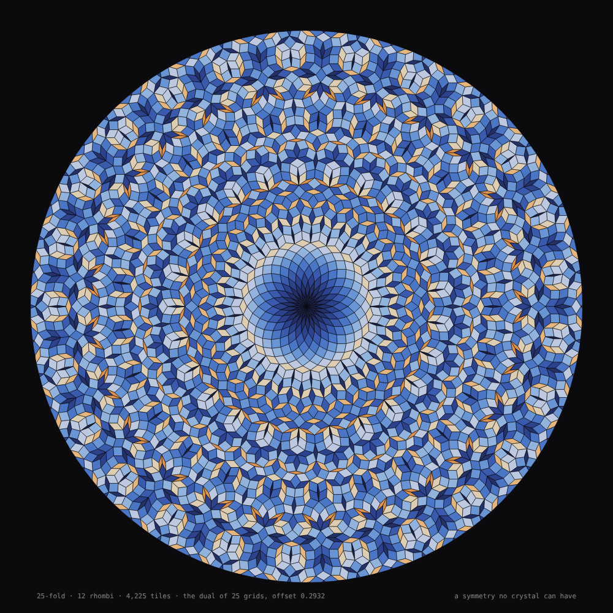
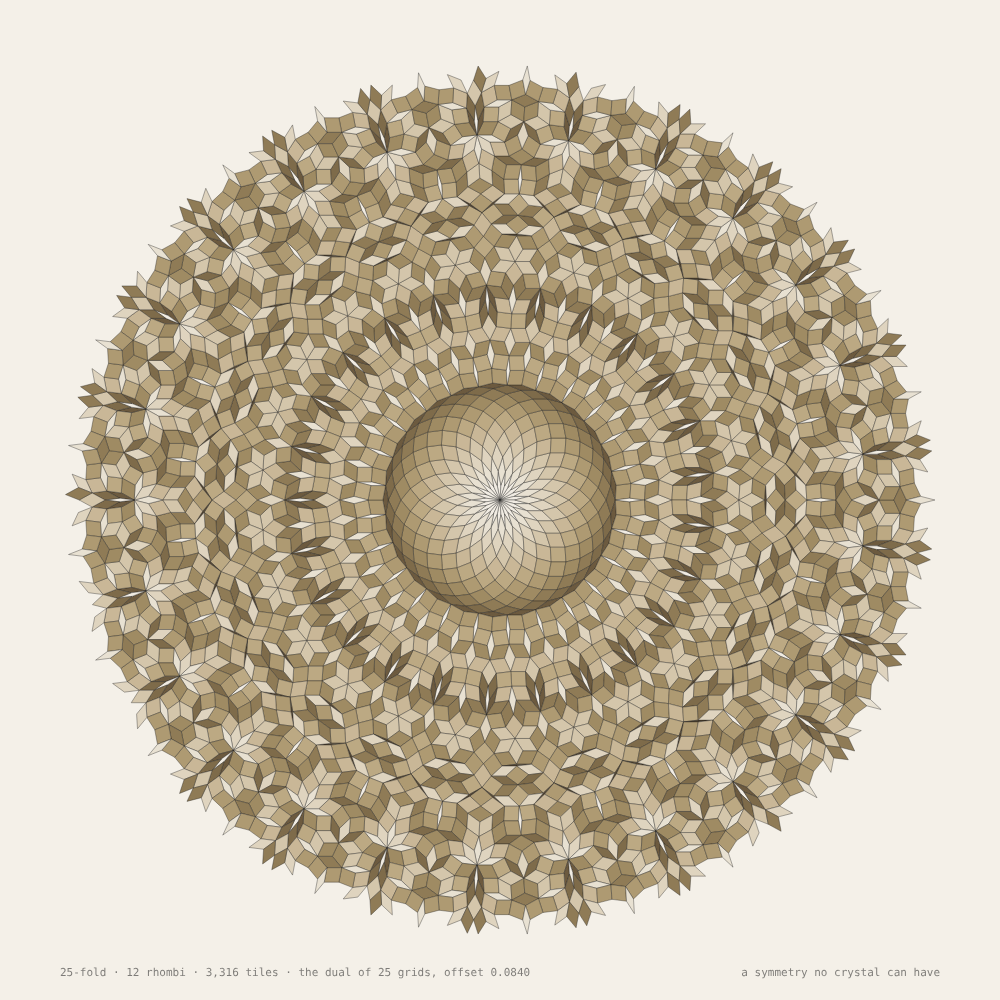

# 046 — Twenty-five-fold

For #PCDTokyo2026 (theme: 25). A crystal can repeat with 2-, 3-, 4- or 6-fold symmetry and no
other — the crystallographic restriction, which every periodic pattern obeys. A pattern that
never repeats is not bound by it. This is a tiling with exact 25-fold symmetry: twelve shapes
of rhombus, grown from the centre a tile a frame, then turned through the 14.4° that leaves it
unchanged.

**Mechanism (one sentence):** de Bruijn's multigrid — 25 families of parallel lines, one for
each direction at 2π/25, all with the same offset — read as its dual: every crossing of two
lines is one rhombus with edges along those two directions, placed at the sum of the line
indices around the crossing, so the rhombi fit edge to edge without a gap, the tiling has the
grids' symmetry exactly, and because 25 directions cannot be generated by two it never
repeats.

## The construction

- Directions e_j = (cos 2πj/25, sin 2πj/25), j = 0 … 24. Grid j is the lines x·e_j = k + c
  for whole k, with one offset c for every grid (the seed's choice, 0.08 … 0.42, retried if any
  three lines meet in the window).
- A crossing of line (i, kᵢ) and line (j, kⱼ) gives one rhombus. Its first vertex is
  Σ Kₘ eₘ over all 25 grids, with Kₘ = ⌈p·eₘ − c⌉ for the crossing point p and (Kᵢ, Kⱼ) =
  (kᵢ, kⱼ); the other three add eᵢ, eᵢ + eⱼ, eⱼ. Every edge has length 1, checked.
- The shape is the difference of directions, d = j − i taken mod 25 into 1 … 12: angles 14.4°,
  28.8°, …, 172.8° — twelve distinct rhombi, ⌊25/2⌋ of them, since 180° is not a multiple of
  14.4°.
- With equal offsets the multigrid is carried onto itself by a turn of 2π/25, so the tiling is
  exactly 25-fold symmetric about the centre; the 25 thinnest rhombi meet there in a star.
  Offsets 0 and ½ make all 25 lines concur and are avoided.
- The window is a disc of radius 4 in the grids' plane (9 lines per family, 9,825 crossings for
  seed 1); the dual is whole out to about 0.62 of its reach and ragged beyond, and the sheet
  shows the whole part: 4,225 tiles, 25-fold exactly, counted and symmetric (every count is a
  multiple of 25).

| shape | 1 | 2 | 3 | 4 | 5 | 6 | 7 | 8 | 9 | 10 | 11 | 12 |
|---|---|---|---|---|---|---|---|---|---|---|---|---|
| angle | 14.4° | 28.8° | 43.2° | 57.6° | 72° | 86.4° | 100.8° | 115.2° | 129.6° | 144° | 158.4° | 172.8° |
| in seed 1's window | 250 | 550 | 850 | 1,025 | 1,150 | 1,300 | 1,275 | 1,150 | 975 | 750 | 450 | 100 |

## The sheet

- **Growing:** the tiles are placed in order of their distance from the centre, 60 a second —
  a disc widening for about 70 s, the symmetry visible at the rim the whole way.
- **Turning:** when whole, the disc turns through 14.4° over 60 s and comes to rest exactly on
  itself — the one motion that changes nothing.
- **Resting, fading, again:** 20 s at rest, a 6 s fade, then the next offset (the seed advances),
  another tiling with the same symmetry and none of the same tiles.
- Colour by shape, thin to fat: on the dark ground indigo through blue to sand and amber; on
  paper, twelve tones of ochre. Edges in the ground's colour.

## Controls

Panel: the grids' window (radius 2 … 6; 6 is about 25,000 tiles), edges, tiles a second, the
turn's length (0 for none), the rest, ground, caption. Keys: **R** new offset · **S** save PNG
(the sheet at 2×). `?at=<0 … 1>` shows that share of the tiles, still.

## Posting on neort.io

`neort.html` is the whole piece in one file — `fold.js` and `neort-boot.js` inlined, no
harness, no panel, no CDN — built by `tools/neort-bundle.sh 046-twenty-five-fold
"Twenty-five-fold" fold.js`. The query string overrides (`?seed=7`, `?radius=5`, `?rate=120`,
`?turn=0`, `?ground=paper`, `?at=1`). Post it with the tag `PCDTokyo2026`.

### The post

**Title:** Twenty-five-fold

**Description (EN):**

> A crystal can repeat with 2-, 3-, 4- or 6-fold symmetry and no other: the crystallographic
> restriction, which every periodic pattern obeys. A pattern that never repeats is not bound by
> it. This is a tiling with exact 25-fold symmetry — de Bruijn's construction: 25 families of
> parallel lines, one for each direction, read as their dual, so that every crossing of two
> lines is one rhombus. Twelve shapes of rhombus, grown from the centre a tile a frame, then
> turned through the 14.4° that leaves it unchanged — the one motion that changes nothing.
> Then another offset: another tiling with the same symmetry and none of the same tiles.

**Description (JA):**

> 結晶が繰り返せる対称性は 2、3、4、6 回のみ──結晶学的制限と呼ばれ、周期的な模様はすべてこれに
> 従います。決して繰り返さない模様は、この制限に縛られません。これは正確な 25 回対称をもつタイル
> 張りです。ド・ブラウンの構成──25 方向それぞれに平行線の族を敷き、その双対を読む。二本の線の
> 交点ひとつが、ひし形ひとつになります。12 種類のひし形が中心から毎フレーム一枚ずつ育ち、
> 張り終わると、何も変えない 14.4° の回転をします。そして次のオフセットへ──同じ対称性をもち、
> 同じタイルをひとつももたない、別のタイル張りへ。

**Tags:** `PCDTokyo2026`, `25`, `quasicrystal`, `de Bruijn`, `tiling`

Files: `fold.js` (the piece, harness-free), `sketch.js` (panel, keys, export), `index.html`,
`neort-boot.js`, `neort.html` (generated), `preview.png`, `paper.png`.
