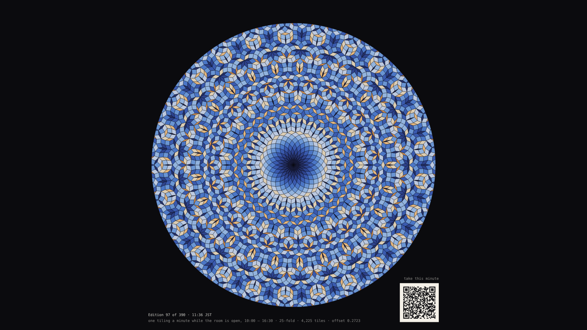
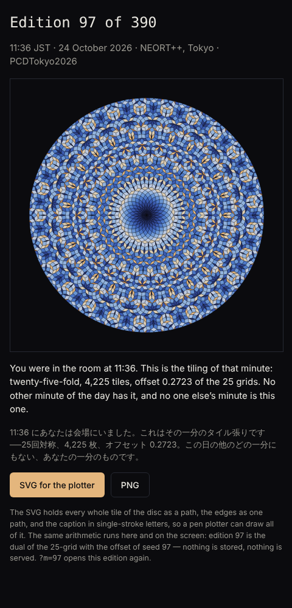

# 047 — Edition of 390

For #PCDTokyo2026 (theme: 25). The exhibition at NEORT++ is open from 10:00 to 16:30 JST on
24 October 2026: 390 minutes. Each minute is one offset of the 25-grid, so one tiling with exact
25-fold symmetry — de Bruijn's dual, as in [046](../046-twenty-five-fold/) — that no other
minute has. The screen grows the current minute's tiling from the centre in about twenty seconds,
rests on it, and at the minute boundary fades into the next. A code in the corner opens the
visitor's page, which reads the phone's clock, regenerates the tiling of that minute with the same
arithmetic, and hands it over as a plotter-ready SVG and a PNG. The visitor leaves with the tiling
of the minute they stood there.

**Mechanism (one sentence):** edition k (1 … 390) is the dual of the 25-grid with the offset of
seed k, computed identically on the screen and on the visitor's phone from the time of day in
JST — nothing is stored, nothing is served, and the 390 are all there is.

## The day

- **Open, 10:00 – 16:29 JST:** the screen is locked to the clock. Minute m of the day shows
  edition m + 1; the caption reads "Edition 97 of 390 · 11:36 JST". At the boundary the disc
  fades over 2 s and the next edition grows at 220 tiles a second — whole in about 19 s, at rest
  for the remaining 39.
- **The code:** a QR (version 5, 37 × 37, error correction M) for
  `https://dmaris70.github.io/generative-art/projects/047-edition-of-390/take.html`, generated
  once and verified to decode from the rendered screen. The page reads the phone's clock, picks
  the minute, and shows the same tiling with "You were in the room at 11:36", in English and
  Japanese, and two buttons: **SVG for the plotter**, **PNG**.
- **Closed:** the screen rehearses — the editions in order from load, one a minute, captioned
  "Rehearsal" with the room's hours — so that the piece is whole at any time of day on neort.io.
  The visitor's page says the room is closed and when it opens, and shows edition 1.
- **Any date:** the clock is the time of day only, so the piece can be checked on any day between
  10:00 and 16:30 JST. On the day it is the day.

## The file the visitor takes

- 250 mm square SVG: every whole tile of the disc as a path, grouped by shape in twelve fills; the
  edges as one path; the caption in single-stroke letters from the repository's plotter font
  (`assets/strokefont.js`) as polylines. Three layers (`fills`, `edges`, `caption`), so a pen
  plotter draws the edges and the caption and a printer prints the fills.
- Edition 97: 3,675 whole tiles, offset 0.2723, 134 caption strokes, 430 kB.
- PNG: the disc at 2,000 × 2,000 with the caption.

## Checks

- 390 editions, 390 distinct offsets, none degenerate (no three lines meet in the window), in
  28 s on Node.
- The clock: 09:59 closed, 10:00 → edition 1, 11:36 → 97, 16:29 → 390, 16:30 closed.
- Headless Chromium with the page clock set to 11:36:10 JST: edition 97 whole at 25 s, caption
  "take this minute"; set to 11:36:40 and run 23.5 s: edition 98 growing at 11:37. Set to 18:00:
  rehearsal from edition 1. The visitor's page at 11:36: "You were in the room at 11:36".
- The QR drawn on the 1600 × 900 screen decodes to the visitor's URL (jsQR).

## Controls

Panel: the edition (0 for the clock, 1 … 390 fixed), the clock (Tokyo time or rehearsal from
load), the grids' window, tiles a second, the fade, ground, the code, caption. Keys: **S** save
PNG · **V** save SVG. `?m=97` fixes the edition; `?at=<0 … 1>` shows that share of the tiles,
still.

## Posting on neort.io

`neort.html` is the whole piece in one file — `fold.js` (046) and `edition.js` inlined with
`neort-boot.js`, no harness, no panel, no CDN — built by
`tools/neort-bundle.sh 047-edition-of-390 "Edition of 390" ../046-twenty-five-fold/fold.js edition.js`.
The query string overrides (`?m=97`, `?clock=load`, `?rate=600`, `?ground=paper`, `?qr=0`,
`?at=1`). Post it with the tag `PCDTokyo2026`. The code points at the gallery page, so
`take.html` must be live on GitHub Pages before the day: merge this and 046.

### The post

**Title:** Edition of 390

**Description (EN):**

> The room is open from 10:00 to 16:30: 390 minutes. Each minute is one offset of the 25-grid,
> so one tiling with exact 25-fold symmetry — a symmetry no crystal can have — that no other
> minute has. The screen grows the current minute's tiling, rests on it, and at the minute fades
> into the next. Scan the code and your phone computes the same tiling from its own clock: the
> tiling of the minute you stood here, as a file for a pen plotter. Nothing is stored, nothing is
> served; the arithmetic is the edition. Outside the room's hours the screen rehearses.

**Description (JA):**

> 会場は 10:00 から 16:30 まで、390 分。一分ごとに 25 本の格子のオフセットがひとつ決まり、
> 正確な 25 回対称──どんな結晶にもありえない対称性──をもつタイル張りがひとつ生まれます。
> 他のどの一分にもないものです。画面は今の一分のタイル張りを中心から育て、休み、分が変わると
> 次へと消えていきます。コードを読み取ると、あなたの電話が自分の時計から同じタイル張りを計算
> します。あなたがここに立っていた一分のタイル張りを、ペンプロッター用のファイルとして。
> 何も保存せず、何も配信しない。計算そのものがエディションです。開場時間外、画面はリハーサルを
> しています。

**Tags:** `PCDTokyo2026`, `25`, `quasicrystal`, `edition`, `plotter`

Files: `edition.js` (the piece; the tiling from `../046-twenty-five-fold/fold.js`), `sketch.js`
(panel, keys, export), `index.html`, `take.html` (the visitor's page), `neort-boot.js`,
`neort.html` (generated), `preview.png`, `take.png`, `boundary.png`.
