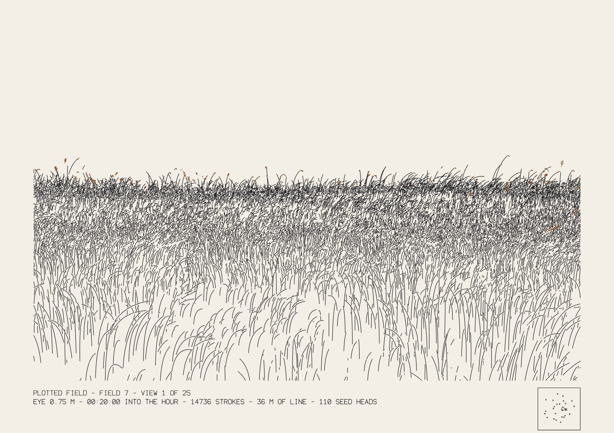
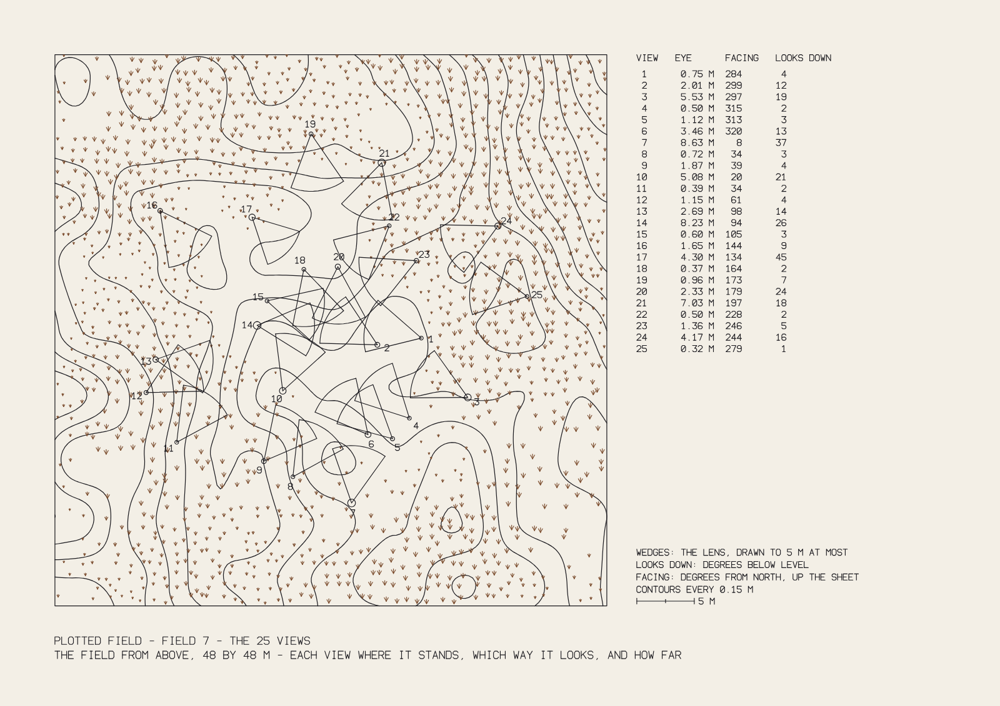

# 048 — Plotted Field

A grass field drawn by a pen plotter, one stroke per blade. One seed makes one field: the
ground, the tufts, how tall the grass is and where each blade stands. That field has 25 views,
each a camera placed somewhere in it, from lying in the grass to standing on a roof. An instant
(the number of seconds into the hour) fixes the wind. Moonlight is shown where the pen lifts: a
blade turned so that it would catch the light is left as a gap in its line. Some stalks carry
seed heads, drawn with a second pen. A 26th sheet, the map, shows the field from above with
all 25 cameras, and every view sheet carries a small copy of that map with its own camera
marked.

**How it works, in one sentence:** blades and patches of ground are sorted from near to far;
each blade's centreline is drawn only where nothing nearer has covered the paper; then the
blade's own width is marked on an occlusion map, so nothing behind it gets drawn.

## Where it comes from

This piece takes one idea from Leander Herzog's *Field* (2026) and goes the other way with
it. *Field* is a live, glowing grass field on the graphics card, where each token is a camera
and the touches people leave fade after seven seconds. Here the same kind of subject becomes
one moment fixed in ink, with no server, no special browser and nothing that changes once
plotted. **No code was taken from *Field*:** I read its source for analysis only, and
everything here (terrain, tufts, wind, cameras, hidden-line removal, light) was written for
this repository from scratch.

## The rules

- **The field depends on the seed and nothing else.** Blades are placed per 1 m world cell, with
  random numbers drawn from a hash of that cell and always in the same order. So view 3 and
  view 17 of a seed show the same blades from different places.
- **The ground:** layered sine waves plus value noise, about ±1.5 m, with no cliffs. **The
  meadow:** low-frequency noise sets grass height (0.18–1.18 m) and how thick it grows.
  **The tufts:** blades group around nearby centre points (cell size 0.85 m). Each tuft has
  its own height, and its blades lean outward from the centre.
- **The wind at an instant:** gusts cross the field as bands along a direction set by the
  seed, slightly warped by noise. The parameter `instant` (0–3599 s) is the moment that gets
  frozen. Each blade is a curve whose bend combines its own lean with the local wind.
- **The 25 views:** placed in order around the field's centre, each pointing roughly at it.
  Eye heights run from 0.3 m to 9 m on a log scale and are shuffled across view numbers, so
  neighbouring views differ in height. Each view looks down far enough to see some ground.
- **Light means the pen lifts:** for every sample along a blade, the engine checks how
  strongly the blade's direction would reflect the moon toward the viewer (a sheen model like
  the one used for hair), weighted toward the tip. Where that exceeds `1 − moonlight`, the
  stroke breaks.
- **Hidden lines:** the occlusion map has a resolution of `grain` mm (0.2 mm by default). A
  blade covers its real width (4–8 mm at the base, tapering to 15% at the tip) times `body`,
  as seen from the camera. Where that is narrower than one map pixel, it covers the pixel at
  random, in proportion to its width. Patches of ground also block what is behind them, so a
  rise hides what lies beyond it.
- **Recession:** blades smaller than `cutoff` mm on paper are skipped. Beyond `haze` m, the
  share of blades kept falls as (haze/distance)², which keeps the number of marks per square
  millimetre of paper constant, and then falls further exponentially with `hazeLength`.
  Distance shows as fewer lines, not as grey. Skipped blades block nothing.

## Seed heads (second pen)

- **Which blades:** a share (`heads`, 0.08 by default) of the taller blades, weighted toward
  height. The choice uses a hash of the cell and the blade's index, kept separate from the
  cell's random sequence, so blade placement is the same as without heads and every view
  agrees on which blades carry one.
- **The stalk:** a blade that carries a head is 25–55% longer, bends half as much and is
  thinner, so the head stands above the leaves.
- **The head:** a spine 9–21 cm long that continues the stalk's tip, either upright or nodding
  (40% nod), with 5–10 spikelets alternating along it. Hidden-line removal applies to the head
  like any blade, and its spine blocks what is behind it.
- **In the SVG:** layer `2 seed heads (pen 2: …)`. The second ink can be sepia (default),
  green, grey or black. Its colour only matters on screen; at the plotter you swap the pen.

## The map (sheet 26)

- **The ground** as contour lines every 0.15 m, worked out from the same ground function as
  the views (marching squares on a 0.3 m grid, segments joined into lines). The map covers
  48 × 48 m around the field's centre.
- **Tall grass** in the second pen: a three-stroke tuft wherever the meadow is taller than
  0.55 m, sized by height and thinned by density. This is the same meadow function that sets
  blade height in the views.
- **The 25 views:** each camera is a circle that grows with eye height, a wedge as wide as the
  lens (drawn out to where the view's centre line meets the ground, 5 m at most), and its
  number.
- **Legend:** a table of eye height, compass facing (north is up the sheet) and how far each
  view looks down, plus a 5 m scale bar.
- **The inset:** every view sheet has a 30 mm square in the caption band at A3, showing all 25
  positions and this view's wedge.

## Measured (A3, default settings, all 25 views)

| Field | Strokes (min / median / max) | Line drawn | Estimated plot time | Build time in the browser |
|---|---|---|---|---|
| 7 | 4,347 / 12,306 / 24,965 | 20 / 40 / 74 m | 52 / 128 / 233 min | 0.1–1.0 s |
| 2026 | 4,008 / 20,095 / 38,107 | 25 / 62 / 110 m | 49 / 195 / 357 min | 0.4–1.1 s |

These figures include seed heads, the caption and the inset map. Compared with the version
without heads, the median sheet has 2% more strokes for field 7 and 20% more for field 2026,
whose meadow is taller. The map sheet has 5,628 strokes (about 57 min) for field 7 and 4,001
(about 43 min) for field 2026.

The plot-time estimate assumes the pen draws at 25 mm/s, spends 0.45 s per stroke on
lifting, moving and lowering, and takes 3 minutes per pen change. It has not been checked against a real machine yet. Low views,
inside the grass, give the fewest strokes; views from about 2–5 m give the most.

Same settings, same file: two builds of field 7, view 24 produce identical SVGs (same
SHA-1). Changing `instant` changes the file.

## Using it

- **URL:** `?seed=7&p_view=24&p_instant=1800`. Every setting in the panel has a `p_` name
  and is written into the URL as you change it.
- **Keys:** `[` and `]` step through the views, `M` switches between the view and the map,
  `V` saves the SVG, `S` saves a PNG, `R` picks a new field. For the map in the URL, use
  `p_kind=1`.
- **SVG:** paper size in millimetres, with one Inkscape layer per pass, in plotting order.
  A view has `1 grass`, `2 seed heads (pen 2)` and `3 caption and map`. The map has
  `1 contours`, `2 tall grass (pen 2)` and `3 views and legend`. All text uses the
  single-stroke font in `assets/strokefont.js`, so the plotter draws it too.
- **Plotting:** run `tools/plot.sh plotted-field-7-view-24.svg a3 23mm` (for A3, the margin
  is 5.5% of the sheet width). The `linemerge` and `linesort` steps in that script do most of
  the work of cutting pen travel. *I have not run vpype on these files, because it is not
  installed in this environment.*

## The wall (`wall.html`): a kinetic version for large screens

Made for a 16:9 LED wall in a public office that runs for months. The screen shows the pen
drawing a sheet in the order a plotter would draw it.

- **One sheet per hour of local time:** views 1–25 of a field, then its map, then the next
  field. That is a 26-hour cycle, so a view does not fall at the same hour on consecutive
  days.
- **Within the hour:** the pen draws for 50 minutes, the finished sheet rests, and it fades
  out over the last 30 seconds. The wind on each sheet is frozen at the moment the pen lifts
  (50 minutes into the hour), and the caption says so.
- **Plotting order:** strokes are sorted by nearest neighbour over their end points (a stroke
  can be drawn backwards), and the pen layers come in sequence with a pen change between
  them. On field 7, view 12 this cuts pen-up travel from 605 m to 21 m, which also shortens
  real plots. The function is `orderStrokes` in `field.js`.
- **Pace:** real plotter timings (25 mm/s drawing, 75 mm/s travel, 0.15 s per lift, 20 s per
  pen change) are scaled so each sheet fills its 50 minutes. Across field 7's 26 sheets this
  ranges from 0.7× to 3.6× a real plotter's speed; a full field would take 40 hours to plot.
  The status line on screen gives the multiple.
- **Locked to the clock:** what is on screen is worked out from the time alone. A reload, a
  power cut or a second screen all come back to the same stroke. The page reloads itself
  once a night at 04:07, sheets are built in a Web Worker so drawing never stalls, and it
  asks the browser to keep the screen awake.
- **Comfort on LED:** warm-white and ochre ink on near-black (`?ink=paper` for the light
  version). Brightness drops to 60% from 19:00 to 22:00 and to 35% from 22:00 to 07:00
  (`?dim=19-22:0.6,22-7:0.35`).
- **URL settings:** `?field=7` keeps one field (by default a new field every 26 h),
  `?slot=60` (minutes per sheet), `?draw=50` (minutes drawing), `?hud=0` hides the status
  line, `?reload=-1` turns off the nightly reload. For a rehearsal, `?at=2026-11-02T14:20&speed=60`
  starts the clock at that time and runs it 60 times faster.
- **Running it:** a full-screen browser in kiosk mode, set to start on boot, pointing at
  `wall.html`. It needs no network once loaded. *Not done yet: a 72-hour unattended test on
  the real screen hardware.*

## Known limits

- The occlusion brush is square, not round. At a 0.2 mm grain this does not show in a plot.
- A patch of ground blocks what is behind it only once all blades up to its farthest corner
  are drawn. A blade just behind a 1 m crest can occasionally show through by a few
  millimetres.
- Each blade is drawn as a single centreline, so the line weight is the pen's. Blade width
  affects only what gets hidden, not how thick anything looks.

## Files

- `field.js`: the engine. It is pure geometry with no drawing library, runs in a browser or
  in Node, and builds the view sheets, the map sheet and the SVG, as pen layers of strokes in
  millimetres.
- `sketch.js`: the panel, the on-screen sheet and the PNG/SVG export.
- `index.html`, `preview.png` (field 7, view 1), `map.png` (field 7, the map).
- `wall.html`, `wall.js`, `wall-worker.js`: the kinetic version for screens.
