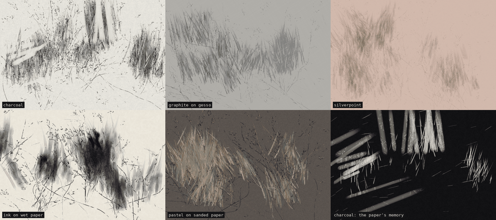

# 048 — Tooth and Wind

An animated charcoal drawing of a reedbed that never finishes, also playable in graphite,
silverpoint, ink and pastel. Stalks are drawn up from the
ground and lean in a moving wind; grey plumes are scumbled with the side of the stick, rubbed
smooth with a finger, lit from inside with an eraser and edged in black; dabs are thrown down
the wind. When the sheet fills, an eraser takes a region back, and the drawing grows again
over what is left of it.

**Mechanism (one sentence):** a simulated sheet — a paper height map plus charcoal and chalk
fields — is worked one footprint at a time by four tools (stick, chalk, finger, eraser) whose
gestures are bent by a seeded, turning wind field crossed by gusts, and the eraser burnishes
the paper so every erasure stays in the sheet as a place that takes less charcoal.

## Point of departure

A charcoal study of reeds or grasses: long broken diagonals, flame-shaped grey masses with
striated interiors and dark edges, tapered dabs, scumbled hatching, and white streaks drawn
out with an eraser. The piece takes that vocabulary as grammar — each kind of mark is a rule,
not a picture — and adds what a still drawing cannot have: time, wind and loss.

## What departs from the source

| In the source | Here |
|---|---|
| marks laid once | marks drawn live, one footprint a frame, so the drawing is watched being made |
| one wind, implied by the lean | a wind field that turns over minutes, gusts that cross the sheet as fronts, and a lean that follows it while a stroke is still being drawn |
| the eraser makes the lights | the eraser also manages time: when the sheet passes a fill threshold it sweeps the darkest region back |
| paper is a surface | paper is a material: its tooth decides where charcoal catches, and erasing polishes it |
| one sheet | the viewer's drag is a finger in the charcoal and a breath of wind; three grounds (bone, toned with white chalk, night) |

## The sheet

Three fields, one value per pixel (internal resolution capped at ~1.35 Mpx):

- **T — tooth.** Per-pixel fibre noise + value-noise octaves at ~2, 5 and 15 px + faint laid
  lines, normalized to [0, 1]. High = a peak of the paper.
- **C — charcoal**, **K — chalk**, both in [0, 1].

Rendering: paper colour shaded slightly by T, mixed toward charcoal by C, then toward chalk
by K. Night inverts the result.

## The tools (one footprint each)

- **Stick** (charcoal or chalk). Deposit = `pressure · falloff · grit − (1 − T) · tooth`;
  only the positive part lands, saturating. Light pressure catches on the peaks and breaks into
  grain; hard pressure fills the valleys. Laid on its side (`ell` > 1) the footprint is narrow
  along the stroke and broad across it, and a per-stroke grit table pulls it into parallel
  striations — the texture of the plumes. Chalk also partly buries the charcoal under it.
- **Finger.** Carries a load: each footprint lays its load down (independent of the tooth, so
  smudges are smooth) and picks up a weighted average of what is under it. Pigment is moved,
  not added.
- **Eraser.** Lifts C (and half as much K) with a crisp kneaded edge and lowers T. Burnished
  paper takes less charcoal later: the ghost of every erasure is in the paper, not a layer.

A gesture (a *hand*) advances a few footprints a frame along a heading. Its pressure and
radius follow attack/release tapers; a two-octave noise along its length drops pressure to
zero where a dry stick skips; its heading curls on its own noise and is pushed by the wind,
limited to a maximum deviation from where it started, so a stalk leans rather than lies down.

## The grammars

| Grammar | Built from |
|---|---|
| **Stalk** | a long thin broken charcoal stroke from below, leaning with the wind; may shed leaf flicks to one side |
| **Tuft** | 2–6 stalks fanned from one root |
| **Plume** | 18–34 side-of-stick strokes converging upward to jagged tips, 2–6 spikes, then 3–8 finger passes, 1–5 eraser lights (with chalk on toned), and 1–5 broken black edge strokes on one side |
| **Hatch** | 4–13 near-parallel light strokes at a diagonal set by the wind |
| **Splatter** | 4–16 flicks thrown down the wind: a heavy landing tapering to a point |
| **Long line** | a reed crossing the whole sheet |
| **Gust** | a front sweeping across in the wind's direction, smearing charcoal along itself and throwing dabs and light streaks |
| **Sweep** | 4–9 broad eraser strokes (and finger passes) over the darkest of 12 probed sites, triggered when sampled charcoal coverage exceeds *fill* |

Hands are spawned around 2–5 **stands** — drifting centres with their own fan direction and
mix of grammars, each living 10–35 s before being replaced — on a slow sinusoidal breath, so
activity rises and falls.

## The materials

The same hands, wind and grammars run in five media. Each medium reads the hands through its
own tools, makes its own paper, renders its own pigment, and answers a full sheet in its own
way. That last point is the main difference between them: what each material allows you to
take back.

| Medium | Paper | How the hands are read | When the sheet is full |
|---|---|---|---|
| **Charcoal** | mould-made sheet: fibre, grain, laid lines | as described above | an eraser sweeps the darkest region; the burnished tooth keeps a ghost |
| **Graphite on gesso** | gesso: two brushed coats crossing, little tooth | thinner strokes; smudges ~35% more; erases almost clean (burnish ≈ ⅓ of charcoal's); white lights become eraser lights | the same eraser sweep, leaving fainter ghosts. The graphite shines: a slow raking light crosses the sheet, and only the graphite answers it (on the dark ground it is seen by its shine alone) |
| **Silverpoint** | bone-dust ground, fine and even; light, rose or blue-grey | no finger, no eraser: silver cannot be smudged or removed. A side-of-stick mass becomes 2–6 parallel hatched lines; white chalk becomes white heightening | the sheet is **finished**: drawing stops, every line goes on tarnishing (each pixel keeps the time its silver was laid, and moves from cool grey to brown over ~40 s × *tarnish speed*), then a new sheet begins |
| **Ink on wet paper** | mulberry sheet with long fibres | lines become brush strokes that run dry along their length; masses become washes; the finger becomes clear water; the eraser becomes a blot; chalk becomes white gouache | ink cannot be taken back, so a thin **white veil** is brushed over the darkest region and drawn over |
| **Pastel on sanded paper** | grit: sharp, dense tooth | opaque colour from a seven-stick palette chosen by role (masses take the middle sticks, stalks and dabs the dark ones, lights the palest); the finger drags colour | the tooth **fills** (each deposit uses up capacity) until the paper takes no more; then **fixative**: it gives back 60% of the tooth and darkens what it fixes by ~7%, and the next layer goes on top |

**Ink: the wet sheet.** Two more fields, water and suspended ink, are stepped every frame on
32 px tiles that are wet (half of them per frame, in a checkerboard). Ink spreads between wet
neighbours; water runs to the drier neighbour and carries ink with it, so ink gathers at a
drying edge; a flooded cell bleeds into dry paper along the fibres; wind dries the sheet, and
as water leaves, the ink it carried fixes to the paper.

**The paper's memory** (*view*). Every medium also records what was taken away: erasures
weighted by the pigment they lifted, blots, white veils, fixative. This view shows only that
record, light on dark. Silverpoint has nothing to show, because nothing can be taken away.

Grounds are *light · toned · dark* for every medium, and each medium reads them its own way:

| | light | toned | dark |
|---|---|---|---|
| charcoal | bone | grey, with white chalk | night (inverted) |
| graphite | white gesso | grey gesso | black gesso |
| silverpoint | bone | rose | blue-grey |
| ink | washi | toned washi | night (inverted) |
| pastel | late summer on buff | dusk on warm grey | frost on slate |

## Controls

| | |
|---|---|
| medium · view · silverpoint tarnish speed | the material |
| gestures a second · pace · weight of the plumes | the hands |
| wind · gustiness | the weather |
| tooth · smudge · eraser · fill before erasing · ground · caption | the sheet |

Only the seed, the medium and a window resize rebuild the sheet (for pastel the ground too,
since it carries the palette). Every other setting changes the weather over the drawing
already there.

Keys: **R** new seed · **S** save PNG · **G** gust · **E** erase · **Space** pause · **C** cast.
Drag to smudge and blow; double-click to throw a splatter. `?gui=0` (contact-sheet tile)
develops 1,800 frames (30 s) off-screen and holds still.

## Casting to a TV

**▭ Cast to a screen (C)** in the panel (Chrome and Edge, desktop and Android) uses the
Presentation API. With a Chromecast, Chrome renders the receiver page, which is this page with
`?present=1`, in a tab of its own off-screen and streams it to the TV. No Cast app has to be
registered, and the drawing runs at the computer's speed, not the dongle's.

- The receiver shows only the piece: no panel, caption, back link or cursor.
- It starts the same seed and settings on a fresh sheet, at the TV's proportions, so its
  composition differs from the laptop's.
- From then on the casting page is its remote. Setting changes, new seeds, G, E, Space, drags
  and double-clicks are sent as messages and replayed on the TV.
- Press C again to stop. If no screen is found, the caption says so.
- In browsers without the Presentation API, use the browser's own tab casting (in Chrome:
  ⋮ → Cast… → Cast tab). Opening `?present=1` directly gives the clean view by itself, for a
  projector.

Determinism: same seed and settings → same sequence, frame for frame, until the viewer
touches it.
