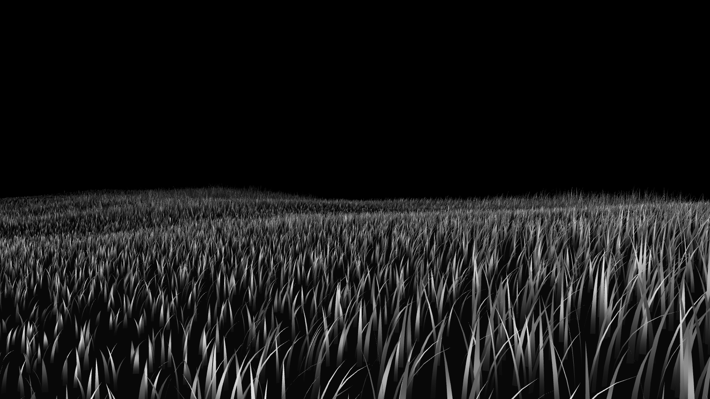

# 049 — Grass Nocturne

A live grass meadow for a large screen. It is lit by a single low light on black, never stops
moving, and is locked to the local clock. A camera drifts through the field slowly, a few
centimetres a second. The light's bearing and height follow the real day: high and flat at
noon, low and raking at night. Gusts of wind cross the field. Every screen running the piece
shows the same moment, and a restart comes back to it.

## How it relates to Herzog's *Field* (2026)

This piece is deliberately closer in look to Leander Herzog's *Field* than
[048](../048-plotted-field/) is: a live monochrome meadow on a dark ground. It is the same
genre, not a reproduction, and **no code was taken from *Field***.

| | *Field* (Herzog) | *Grass Nocturne* |
|---|---|---|
| Camera | 26 fixed viewpoints, each a token, plus a free orbit | One continuous drift whose path is set by the clock and repeats only every 20 days |
| Light | A moon orbiting every 60 s | Bearing and height follow the real time of day |
| People | Visitors' touches are shared live and bend the grass | No interaction; made for a wall |
| Ownership | On-chain: owners shown in the scene | None |
| Technology | WebGPU compute pipeline | WebGL2, every blade computed in the vertex shader; no blade buffers |
| Image | Blur and floating dust motes | Sharp, with distance fog to black |

## The rules

- **The meadow is the same wherever the camera goes.** Each blade comes from a hash of its
  world cell (0.28 m) and its index in the cell. Height comes from smooth noise (tall drifts
  and short lawns), and tufts share a height. Nothing is stored.
- **What gets drawn:** a 46 × 46 m window of cells, shifted ahead of the camera. Beyond 7 m
  fewer blades are drawn, each a little wider, so the field keeps its tone. There are 14
  blades per cell by default (about 380k blade slots), each a 6-segment curve.
- **The camera** (a function of seconds since local midnight): an hourly loop of about 26 ×
  18 m, a 19.5-minute swerve, and a 37-minute rise and fall in eye height from 0.32 m to
  5.5 m, mostly low. It looks 14 m ahead along its path. Top speed is 5.6 cm/s.
- **The light:** its bearing turns once a day, and its height runs from 7° at 01:00 to 38° at
  13:00. Exposure follows the light's height, so the night is darker as well as more raking.
- **The wind:** its direction wanders through the day, and its strength gusts on 97 s and
  411 s cycles. Gust fronts travel downwind across the field with a flutter on top, and each
  blade also has its own lean.
- **Gusts you can see:** a blade bending in the wind shows its paler side, so strong gusts
  appear as bright waves rolling across the field.
- **Cloud shadows:** soft dark shapes, roughly 30–60 m across, drift downwind at 1.8 m/s and
  darken the grass and the ground. The cover changes over 90 minutes, from broken cloud to
  mostly clear.
- **Horizon and mist:** a hedgerow with trees stands on a ring 70 m from the field's centre.
  The meadow fades out over the last 7 m of the drawn window instead of ending in a line, and
  distance fades into a mist lit from the light's side rather than into black. The mist is
  thickest around 06:30 and 19:00. A faint glow at the horizon keeps the tree line visible at
  night.
- **Shading:** a fraction of light that wraps round the blade, plus a sheen along the blade's
  length (strongest at the tip), a rim light, and darkening at the root. Distance fades to
  black, the image is tone-mapped to grayscale, and one step of noise is added to stop
  banding on 8-bit LED panels.

## Drawing quality and dichroic colour

- **Creased blades:** each blade folds along its middle, so its two halves catch the light
  differently. It narrows to a real point.
- **Light through the blades:** when a blade is lit from behind, its edges and tip glow.
- **No blinking at distance:** the last blade kept in a thinned-out cell is drawn in proportion
  to how far it is kept, so the far field fades smoothly instead of flickering.
- **Thin blades stay lines:** a blade narrower than a pixel is widened to one and made fainter
  by the same ratio, so it does not break into dots.
- **Dichroic film:**
  - **How it works:** each blade carries an imagined thin film whose thickness varies a little
    from blade to blade. The colour it reflects depends on the angles to the viewer and to the
    light, and light passing through shows the complementary colour. As blades bend and the
    camera drifts, the colours shift.
  - **Always on:** at 18% strength, as a shimmer on the grey.
  - **Full strength:** in the score's colour mode 8.
  - **The pair changes through the day,** crossing over in the last half hour of each block:
    - 00–06: cyan and magenta
    - 06–12: gold and blue
    - 12–18: green and violet
    - 18–24: copper and teal
  - **Settings:** `?dichroic=0` turns it off; `?dichroic=2` doubles the shimmer.

## The journey and its weather (`weather.js`)

The meadow travels once round the earth in a year, and its weather is the live weather of
wherever it has got to.

- **Where it is:** longitude moves east 0.9856° a day (360° in a year) from a starting meridian
  (`?from=`, default 0°). Latitude swings between 60°N and 45°S over a year and a half, so the
  track does not repeat for three years. Day 1 is 1 Nov 2026. The place follows from the date
  alone, so every screen is in the same place.
- **The reading:** Open-Meteo (free, no key) is asked every 15 minutes for the place rounded
  to 0.1°. Each new reading eases in over 5 minutes. With no reading for an hour (offline,
  refused, over the limit), the piece falls back to its own built-in weather and says so in
  a measurement. It never stops.
- **What each reading does:**

| Reading there | In the meadow |
|---|---|
| Sun's height and bearing | The light's height and bearing. By night there, a low stand-in light from the opposite side, and the field darker but readable. `?light=local` keeps the office's own day instead. |
| Temperature | The dichroic pair: below −10 °C cyan/violet, 5 °C cyan/magenta, 15 °C green/violet, 24 °C gold/blue, above 34 °C copper/magenta, blended in between |
| Wind speed and direction | The gusts' strength and direction; also the direction and speed of the cloud shadows |
| Gusts (over the mean wind) | How hard the gusts pulse, and extra glitch minutes: up to 1.64× as many in a gale |
| Cloud cover | How much of the field is in cloud shadow |
| Humidity, visibility, fog | Haze: dry air sharp to the trees, fog closing the field in to about 10 m |
| Rain | Falling lines in three depths, slanted by the wind across the view; the meadow darker |
| Snow | Slow short marks; motion slowed by 60%; greys lighter; colour drained |
| Pressure | The camera's height: low pressure keeps the eye in the grass |
| Pressure over 3 hours | The horizon tilts, up to 2°, falling one way and rising the other |
| Thunderstorm | Single inverted frames, at random-looking but reproducible moments |
| Night there | Colour at half strength |

- **Five more measurements** join the 30-second cycle, so 15 kinds every 7.5 minutes:
  - the place and the solar time there, with the sun's height and the day of the journey
  - wind and gusts
  - pressure and its trend, humidity, temperature
  - cloud, visibility, precipitation
  - the weather code with its name, or "no reading" and the reason
- **Network:** the wall needs outgoing access to `api.open-meteo.com`. That is 96 requests a
  day per screen, far below the service's free limit. The preview link on claude.ai cannot
  reach it, so there the piece shows its built-in weather.

## The ground under the journey (`geography.js`, `data/`)

The piece knows the earth offline. It reads a 0.25° grid (1440 × 720 cells) built by
`data/build_geo.py` from public data:

| Layer | Source | License |
|---|---|---|
| Country of each land cell; sea or ocean name of every cell; 2,512 cities (population ≥ 150,000, or a capital) | Natural Earth, 1:50m and 1:10m | Public domain |
| Elevation on land | ETOPO 2022, NOAA National Centers for Environmental Information, sampled every 0.5° | Public domain |
| Distance to the coast | Computed from the land mask (shortest path over the grid, in km) | — |
| Climate zone (not yet added; see below) | Köppen-Geiger V3, Beck et al. (2023), *Scientific Data* 10, 724, 1991–2020, 0.5° | CC BY 4.0 |

Country names and borders are Natural Earth's, which show de facto boundaries. Names appear
only as text in the measurements, never as a picture of a map.

**What the ground does.**

| Fact | In the meadow |
|---|---|
| **Sea or land** | Within 20 km inland the sea begins to show, and by 40 km offshore it is full. At sea the waterline rises to just below the horizon (55% of the screen at most), and the meadow thins to a fringe of tall reeds standing in water. |
| **Elevation and roughness** | The ground's relief grows with height and with how much the land varies nearby, up to three times. Air is thinner higher up: less haze and slightly brighter. |
| **Latitude** | Grass is up to 35% shorter toward 60° and up to 15% taller at the equator. |
| **Climate zone** | Once added: tropical is dense and tall; desert is sparse, short and pale; steppe is tufted and combed by wind (more charcoal); temperate is today's meadow; cold is shorter; tundra is low; ice is almost bare. |
| **At sea, at night** | Brighter exposure, so the sparse reeds still read. |

**Crossings.**
- The **equator** mirrors the image for an hour.
- The **date line** gives ten minutes of time slice.
- A **tropic** brings a day with half as many colour minutes again (304 instead of 211).
- Coastlines, borders, seas and every 15° of longitude are logged; a measurement reads the
  most recent.

**Five more measurements** (20 kinds, all every 10 minutes):
- the ground (country or sea, distance to the coast, height, climate)
- the nearest city, its distance and bearing
- distance travelled, and the next landfall or departure to sea
- the last thing crossed and when
- the antipode, and whether it is land or sea

**The first year** (from 0° on 1 Nov 2026): 60% of the time at sea; 11 countries (Italy, France,
Croatia, Bosnia and Herzegovina, Serbia, Hungary, Romania, Ukraine, Russia, Chile, Argentina);
33,600 km.

**The climate map is not in yet.** figshare, which hosts it, answers automated downloads with a
bot challenge, so it could not be fetched from here. To add it:
1. Download `koppen_geiger_tif.zip` from https://doi.org/10.6084/m9.figshare.21789074.
2. Put its 0.5° 1991–2020 map, `koppen_geiger_0p5.tif`, in the source folder as
   `koppen_0p5.tif`.
3. Run `python3 data/build_geo.py <sources> data`.

The engine picks it up without other changes. Until then the measurement says
`CLIMATE MAP NOT YET ADDED`, and the meadow ignores climate. `?geo=0` ignores the ground
altogether.

## Four registers, borrowed as techniques

Four ways of making marks are layered over the meadow, and the weather where the journey is
decides how much of each. They come from references for ink wash, high-key photography of
reeds in water, and charcoal drawing. Only the techniques are taken; no composition is copied.

| Register | What it does | Driven by |
|---|---|---|
| **Paper and ink** | The night becomes paper and the light becomes ink. Colour turns to its complement, as a dichroic film shows by transmitted light. The ink follows the frame's own brightness (its 90th percentile), so a dark, wet field still draws. | Daylight where the journey is (the sun from 4° below the horizon to 10° above). `?paper=0` never uses paper. |
| **Wash** | Tone bleeds, pigment pools at the edge of a wash, and granulation runs through the paper. | Humidity, rain and fog |
| **Charcoal** | Tone is dragged a short way along the wind's direction across the screen, and a dry brush skips over the paper's tooth. | Wind strength |
| **Water** | Below a waterline the meadow is seen reflected in moving water. The ripples are a continuous field: fine and quick near the horizon, broad and slow near the eye, drifting with the wind. When it is wet, a few thin, broken threads of light hang from the line like ink lines in a wash. | Always present, at 14% to 34% of the screen height, rising with humidity and rain; at sea, just below the horizon. Ripples follow the wind; threads appear only with humidity, rain or fog. |

**Automatic exposure.** Every second the piece measures its own frame's brightness (the 90th
percentile of a 320 × 180 copy). A dark frame (night, storm, rain, open sea) is lifted, up to
4×, until that reaches 0.32. Bright frames are left alone, and the change eases in over a few
seconds. Night stays darker than day but never becomes a black wall.

**The near field, faded.** Grass within about 4 m of the eye dissolves into soft, mottled,
grainy pools of washed-out light and loses its contrast. *Field* has a faded quality in its
near grass too; here it is done as a wash and grain rather than as lens blur. It is stronger
when the air is wet where the journey is. The grass and ground write their nearness into the
scene's alpha channel, and the finishing pass reads it. `?near=0` turns it off, `?near=1.5`
strengthens it.

`?style=nocturne|ink|wash|charcoal|water` holds one register for checking. The weather
measurement now also gives the four weights.

## The score: glitches, colour and measurements

Over the meadow runs a score of abstract events (`score.js`). Nothing in it is random at run
time and nothing is accidental: the moments come from prime numbers, the choices from a hash of
the date and minute. Every screen shows the same event at the same second.

| Layer | When | Rate |
|---|---|---|
| **Glitch** | Every minute of the day (0–1439) that is prime, starting 5–40 s into it and lasting 6–20 s; never in the minute after a colour minute | 227 a day, about 9.5 an hour |
| **Colour** | Every minute whose clock time read as a number is prime (14:23 → 1423); the whole minute, fading in and out over 4 s; eight modes | 211 a day, about 8.8 an hour |
| **Measurement** | Every 30 s without break; all fifteen kinds every 7.5 minutes, in a shuffled order, never the same twice in a row | 2,880 a day |

**Glitches, each an idea.**
1. *Time slice*: each column is a different second, from now (left) to 40 s ago (right).
2. *Echo*: a band showing the field 60 s ago.
3. *Sorting*: blades slide across the screen to the place their height ranks them.
4. *Transposition*: the wind turns a quarter.
5. *Quantisation*: positions snap to a grid that halves six times.
6. *One bit*: no greys.
7. *Identity*: each blade drawn as the bits of its own hash.
8. *Mirror* (rare).
9. *Inversion* (rare).
10. *Recursion*: the view nested inside itself.

Mirror and inversion pass only one time in eight, about six times a day between them.

**Colour, as something encoded.**
1. Each blade's colour from its hash.
2. Distance as hue: near warm, far cool.
3. The time of day as a point on the colour wheel.
4. Each tuft one colour.
5. A colour and its complement, split down the middle of the screen.
6. A single primary.
7. Colour carried by the wind.
8. Dichroic at full strength.

**Measurements.** All are drawn in the single-stroke letters of 048 and read the same functions
that draw the image:
- A blade's cell, hash, height and distance.
- The probability that a blade at that distance is drawn.
- The census of blades and triangles in the frame.
- Frames since 1 Nov 2026 at 60 fps.
- The next prime minute and the next prime clock time.
- The phases of the camera's three cycles.
- Time until the path repeats.
- The wind as a vector, drawn as an arrow in the field.
- The entropy of the frame's brightness.
- Today's count of events.

While a glitch or a colour is on, its cause is lettered low on the left, for example
`GLITCH 7 - IDENTITY - MINUTE 853 IS PRIME`.

**The logbook.** `NocturneLog('2026-11-02')` in the browser console lists every glitch and colour
minute of a day, with its time and the reason for it.

**How it is drawn.** The scene is rendered with 4× antialiasing into a texture, then a
finishing pass applies the whole-image glitches and colours. One frame a second is kept at
320 × 180 in a ring of 64, which feeds the time slice and the echo.

## On a wall

- **Dimming:** to 60% from 19:00 to 22:00 and 35% from 22:00 to 07:00
  (`?dim=19-22:0.6,22-7:0.35`; `?dim=` turns it off).
- **Settings:** `?blades=4…24` (blades per cell) and `?scale=0.5…2` (render resolution) adjust
  it to the GPU. `?hud=0` hides the status line, `?seed=N` gives a different meadow.
- **Diagnostics:** `?show=clouds` and `?show=gusts` display the cloud shadows or the gust
  waves on their own, for checking at installation.
- **Weather:** `?weather=0` uses the built-in day instead of the journey; `?from=<longitude>`
  sets where the journey starts; `?light=local` keeps the office's own day.
- **Holding one event:** `?glitch=1…10`, `?colour=1…8` and `?measure=1…15` hold a single event on
  screen for checking. `?score=0` turns the score off.
- **Rehearsal:** `?at=2026-11-02T21:40&speed=60` starts the clock at that time and runs it 60
  times faster. `?still=1` holds the clock and draws a single frame, for thumbnails.
- **Running it:** a full-screen browser in kiosk mode, set to start on boot. It needs no
  network once loaded, and asks the browser to keep the screen awake.

## Verified

- **The schedule in Node:** eye height stays between 0.32 and 5.52 m over 24 hours. Light
  height is 7° at 01:00, 22.5° at 07:00 and 19:00, and 38° at 13:00. Top camera speed is
  0.056 m/s.
- **Headless Chromium on software WebGL2:** it renders at 08:05, 14:20, 17:12 and 21:40 with no
  console errors. Two frames 2 s apart differ in 32% of their bytes, so the grass is moving.
- **Not checked:** frame rate on a real GPU and on the wall's own computer. The software
  renderer is too slow to measure that. Before installing, find a `blades`/`scale` setting
  that holds 60 fps at the wall's resolution, then run it for 72 hours.
