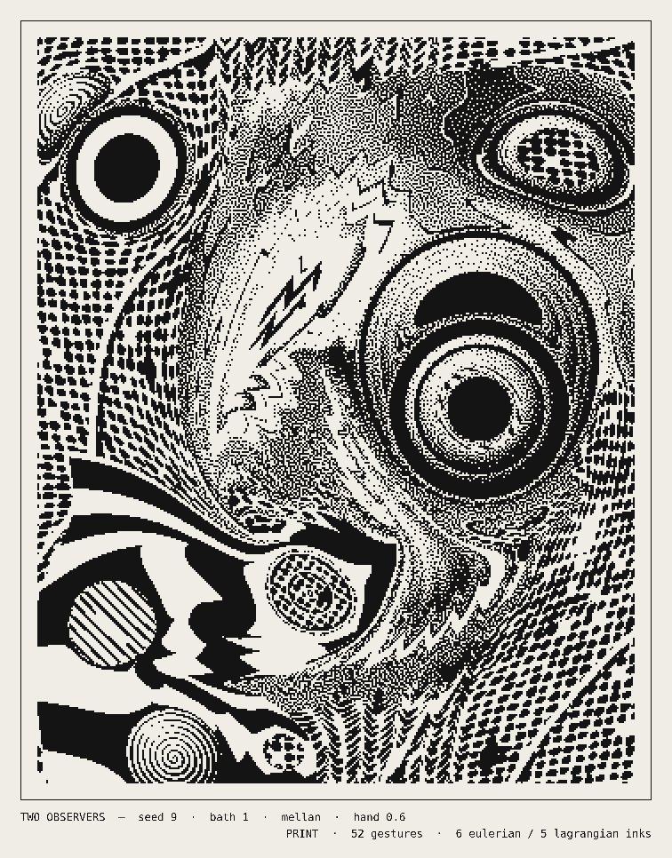

# 049 — Two Observers

A marbling bath in one bit, watched by two observers. A seeded collage of stripes, lattices, bands
and contour fields is floated on the bath; then a score of gestures works it — ink dropped in
concentric stones, combs dragged back and forth, waves, swirls — until the paper goes down and a
print is taken. Every ink is seen by one of two observers. The **Eulerian** observer looks through
a fixed screen on the glass. The **Lagrangian** observer's screen is printed on the ink itself, so
its dots and lines are combed, stretched and folded with the material. Where the ink is squeezed
finer than the eye can resolve, the fixed observer takes over. Two more observers come from
physical work: **Soto**'s fixed striped panel, seen through ink that carries its own lines, so
the combing makes the moiré swim and the viewer's position moves the panel; and **Mellan**'s
single spiral line, whose width is the tone, engraving drops as lit spheres that the comb then
drags — and that leave the screen as a pen-plotter drawing. And the screens the ink carries are
painted by **hand**, after Polke's raster paintings, while the screens on the glass stay machined.

**Mechanism (one sentence):** every gesture is an exact, invertible map of the plane, so the bath
at time *t* is found by pulling each pixel back through the gestures that have started, newest
first, until it lands in a drop's ink or on the ground — nothing is simulated or stored between
frames, and any moment of any bath can be rendered directly from (seed, bath, t).

## Foundation and departure

The starting point was a 24-second loop posted by the creative coder loackme
([@loackme_](https://x.com/loackme_/status/2112194803622441179), 19 October 2026), read frame by
frame: a 1-bit, ordered-dither render (a dither cell of about 4 px at 1040 × 1280) of a
grayscale collage — diagonal bands with white and black edges, vertical stripes in a rotated
window, a diamond lattice, nested contour rings — being folded by a slow continuous flow, inside a
thin ruled frame. The post names no tools and its code is not public; that reading is inference
from the pixels.

Kept: the collage of procedural fields in rigid windows, folding motion, contour rings, coarse
1-bit dithering, the ruled plate. Departures:

| | foundation (as read) | Two Observers |
|---|---|---|
| motion | a smooth flow field, warping | the craft of paper marbling: drops, combs, waves, swirls, each an exact, area-preserving map with a closed-form inverse |
| time | a loop, presumably integrated | stateless: frame *t* is computed from the score alone, so time can be scrubbed, linked and printed at any instant |
| dither | one screen for the whole frame | two observers per ink: fixed screens (Bayer 8 × 8, void-and-cluster blue noise) and material screens (dots, lines) carried by the ink, with a resolvability hand-off between them |
| rings | contour bands of a field | also the real thing: stones of concentric drops, deposited one inside another |
| form | an endless loop | sessions: each bath is scored, worked, settled and *printed*, then the print peels away and the next bath is floated |
| record | the video | the score: every bath exports as JSON (ground, inks, observers, gestures, times) — the print is fully described by it |

## The bath

- **Plate:** 4 : 5, coordinates in plate units (1 × 1.25), origin at the centre, y down.
- **Ground (t = 0):** a background field (wavy bands or a smooth noise field) and three to five
  rigid windows — rectangles or diamonds — of hard stripes, a diamond lattice, a contour field
  (iso-lines of fBm) or bands at the cross angle.
- **Inks:** black, white, two greys, a ringed ink and a striped ink, each assigned an observer at
  random with probability *lagrangian share* (0.5 by default).
- **Gestures** (Lu, Jaffer et al., *Mathematical Marbling*, IEEE CG&A 2012), each with a start, a
  duration and smooth-step progress *s*:
  - *drop* at *c*, radius *r*: outside points move out, `p' = c + (p − c)·√(1 + r²s/|p − c|²)`;
    pulled back by `√(1 − r²s/|p' − c|²)`, and a point inside the disc is that drop's ink;
  - *comb* of *n* tines, spacing δ, along direction *M*: `p' = p + z s α/(d + α) · M`, *d* the
    distance to the nearest tine — the shift is along *M*, so *d* is unchanged and the inverse
    is a subtraction;
  - *wave* along *M*: a shift along the normal by `A s sin(ω u + φ)`, *u* the position along *M*;
  - *swirl* about *c*: a rotation by `z s α/(|r − R| + α) / r`, radius preserved.
- **Movements:** six seeded orders of stones, scatters, combs (gel-git, back and forth), a fine
  comb, waves and swirls, always ending on drops — clean ink laid on the worked field before the
  paper goes down. Over 900 scores (seeds 1 – 300, baths 1 – 3, default density): 32 – 71
  gestures (5th – 95th percentile, median 51) and 26 – 44 s of work a bath, then a six-second
  hold on the print.

## The two observers

- **Eulerian:** threshold from the pixel, not the ink — Bayer 8 × 8 or a 64 × 64 blue-noise screen
  generated at load by void-and-cluster (Ulichney 1993).
- **Lagrangian:** threshold from the ink's own coordinates — an AM dot screen or a line screen at
  55 – 95 lines per plate unit and a seeded angle, so it deforms with the ink.
- **Hand-off:** the shader measures how many ink units one pixel spans (screen-space
  derivatives of the pulled-back coordinate). When the material screen's period falls below
  *resolvable period* (2.5 px by default), that pixel is read through the blue-noise screen. The
  border between the two readings is a contour of compression; it shows where the hands squeezed
  the bath.
- **Tone:** a pixel is paper when the ink's tone exceeds its observer's threshold; stripes and
  edges are already 0 or 1 and pass through any screen unchanged.

## Soto and Mellan

- **Soto** (*Vibrations*, rods before striped panels, from the late 1950s). A fixed vertical panel
  on the glass — period *soto panel* cells (4), half ink — behind ink that carries its own
  near-vertical lines at 0.93 – 0.97 or 1.03 – 1.07 of the panel's pitch and up to ±3.4° off it. A pixel is ink
  if the panel or the ink's line covers it, as opaque things superimpose. The two pitches beat:
  wide moiré bands that bend and travel as the comb shears the ink's lines. The pointer is a third
  observer — moving across the window slides the panel through one full period, and the bands run.
  A bath has a Soto panel window (and, rarely, Soto drops) with probability *soto chance* (0.7).
- **Mellan** (*The Sudarium of Saint Veronica*, 1649, a face engraved as one spiral line). Larger
  drops (radius ≥ 0.05) become spheres lit from the upper left, drawn by a single Archimedean
  spiral about the drop's centre at 70 – 100 turns per plate unit, its width the darkness. The
  spiral lives in the ink's frame, so combs and swirls carry it. Present with probability
  *mellan chance* (0.8); about 40 % of the larger drops take it.
- **The plotter layer (V).** Every visible Mellan spiral pushed *forward* through the gestures
  after its drop (the exact forward maps, the inverse of the shader's pull-back), clipped where
  later ink covers it — tested by pulling each point back and checking it lands in its own drop —
  and at the plate edge. One pen: the swelling line is up to five strands side by side, each laid
  only where the engraving is dark enough to need it. Where the combing has stretched the spiral,
  the line is bisected until segments are under 0.4 mm, and the pen lifts where it stays torn.
  SVG in millimetres (160 × 200 plate), one Inkscape layer per drop plus the frame.
- Both draw from their own random stream, so adding them changed no other gesture of a seed's
  score; it does change which ink some drops carry.

## The hand (Polke)

After Sigmar Polke's raster paintings (from 1963), where the halftone dots are painted one by one
and the machine's regularity falls apart in the hand. Here the hand belongs to the carried screens
only: the fixed observer is a machine, the ink's screen was painted.

- **Dots.** Every cell of an ink's dot screen has six values hashed from the cell and the ink, so
  a dot is the same dot from frame to frame and is combed with its ink. The dot wanders off centre
  (±16 % of the pitch at full hand), grows or shrinks (±30 %), goes oval (±22 %) and lobed
  (±14 %); one in twenty is left out, and one in about seventy swells to 1.9 × as a blot that runs
  into its neighbours (each pixel tests the nine nearest dots, so a blot is not clipped to its
  cell). Dot area follows tone; the raster's frequency drops by up to 45 % (its pitch grows up to
  1.8 ×) so the hand can be seen.
- **Lines.** Each ruled line wavers along its length (±21 % of the pitch), thickens and thins
  (±35 %), and breaks where the brush lifted (value noise along the line under 0.22 × hand).
- **Amount.** *hand* (0.6) scales all of it; each ink's own hand is 0.6 – 1.0 of that, from a
  hash, so a bath has heavier and lighter hands. The hand draws nothing from the score's random
  streams: changing it moves no gesture. At *hand* 0 the screens are the machine again — the
  render is identical, bit for bit, to the version before the hand (338,400 cells, 0 different).
- Soto's lines and Mellan's spiral stay exact: an optical construction and an engraver's burin.

## Prints and scores

- **P** — the print: the screen's own bits enlarged by a whole factor to about 4,000 px tall, on
  the paper with its rule and caption. No resampling, no new pixels: the print is what the
  observer saw.
- **V** — the plotter layer as SVG (above). It holds the Mellan lines and the frame only, not the
  bitmap.
- **J** — the score as JSON: seed, bath, session seed, movement, ground windows, every ink with its
  observer and screen, every gesture with its times and parameters.
- **S** — the whole sheet as shown.

## Controls

Space pause / play · ← → scrub one second (Shift: five) · N / B next / previous bath · O the score
drawn over the plate (gestures in progress, in red) · P print · V plotter SVG · J score · S sheet ·
R new seed · pointer across the window: Soto's panel. Panel: *cell* (css px per dither cell, 2 by
default — about the foundation's grain), *speed*, *lagrangian share*, *gesture density*,
*resolvable period*, *soto chance*, *mellan chance*, *soto panel*, *hand*. URL:
`?seed=…&bath=…&t=…&pause=1&par=…` reproduces a moment, `par` being the panel's shift in cells;
the panel writes its own parameters to the link.

## Files

- `marble.js` — score generator, blue-noise screen, the pull-back and every observer on the CPU,
  the forward maps and the plotter layer, packing for the shader, the JSON record. Runs in Node.
- `sketch.js` — the WebGL2 fragment shader (the same arithmetic per pixel), the sheet, the bath
  life cycle, exports. Without WebGL2 it falls back to the CPU path.

## Verification

- GPU against CPU, headless Chromium (SwiftShader), grid 336 × 420, with Soto, Mellan and the
  hand at 0.6: the shader's bits agree with `marble.js` on 99.16 % (seed 9, the print), 99.61 %
  (seed 7, t 12), 99.79 % (seed 21, t 17.1, panel shifted 1.5 cells), 99.10 % (seed 404, the
  print) and 99.59 % (seed 1234, t 25) of cells. Before the hand, the same check gave
  99.21 – 99.74 %. The remainder are pixels whose tone sits on a threshold (float32 against
  float64) or whose derivative crosses a material edge. Frame time there: 200 – 220 ms.
- Forward against inverse: 2,000 random points pushed forward from a random gesture to the end of
  seed 7's score and pulled back return to within 1.4 × 10⁻¹⁴ plate units.
- Plotter layer at the print, seeds 7, 9, 404, 1234: 9 – 13 drops, 189 – 279 polylines,
  43 – 83 thousand points, longest segment 0.40 mm, 0.6 – 1.2 MB, 140 – 200 ms in Node.
- Pointer parallax: moving to the left edge shifts the panel by −1.46 cells within 1.5 s, and the
  moiré bands move with it; V downloads from the page.
- Page life cycle: score overlay, print download (3780 × 4830), score download, auto-advance to
  the next bath with the peel, 0 page errors.
- Composition was tuned on CPU renders of six seeds: the first scores ended on a fine comb and
  shredded the field to grain; every movement now ends on drops, and comb displacements were
  roughly halved.

## Known limits

- Bits are reproducible from (seed, bath, t, parameters) to the agreement above; another GPU can
  differ on threshold pixels. The JSON score is the exact record.
- Material screens are fixed in plate units, so a small window shows a coarser material grain and
  more hand-off to the fixed screen than a large one.
- Cost grows with the number of gestures started (up to 160 per pixel per frame). Frame times
  were measured only under SwiftShader (200 – 320 ms at 336 × 420, CPU-emulated); not profiled
  on hardware GPUs here.
- A comb's progress scales its displacement; a real stylus front travelling along the stroke is
  not modelled.
- The caption is antialiased text; the plate alone is strictly two colours.
- At *gesture density* 1.5 some scores reach the 160-gesture cap; gestures past it are dropped,
  closing drops included.
- Soto's panel is measured in cells, so its pitch — and the ink lines tuned to it — follows the
  window: the moiré's scale is the same on every screen, but the ink lines' plate frequency is not,
  and a print records the screen it was taken from.
- The panel follows the pointer only; device tilt is not read.
- The hand's per-cell values are hashed in 32-bit integers on both sides, but the GPU turns them
  into floats with 24 bits, so a dot whose value sits on a cut-off (left out, blot) can differ.
- The plotter layer is Mellan's spirals and the frame; the rest of the plate is bitmap only.
- The contact-sheet button opens one WebGL context per tile; browsers cap live contexts, untested.
