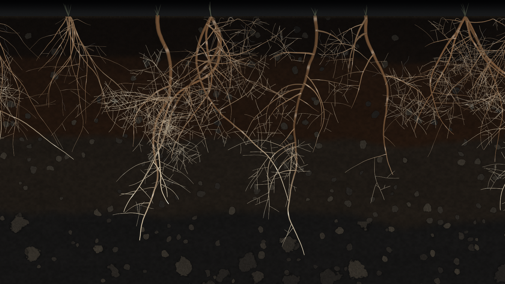

# 050 — Root Section

A floor-to-ceiling cut through the soil, made for a large wall. Roots grow down it over a season,
at the pace the real weather allows. It is locked to the clock. Every screen shows the same moment,
and a restart comes back to it.

This is a **prototype for validation**. It shares 049's conventions (clock, live data, wall
settings), but it is a single file (`roots.js`) and does not yet use a shared kernel.

## The rules

- **A cycle** lasts `days` (92 by default) from `start` (1 Nov 2026). Each cycle has its own root
  network, made from a hash of the cycle number, so a new season brings new roots. In the last 3% of
  each cycle the network fades back into the soil.
- **The network** is built once per cycle: 70–80k segments across a 4.2-unit-wide cut whose depth is
  1 unit (the wall's height). It contains three kinds of plant:
  - tap-rooted forbs: one deep root with laterals;
  - grasses: a fibrous tuft of 9–15 fine roots;
  - shrubs: 3–5 wide, shallow roots.

  Roots turn toward gravity, wander a little and branch, and each branch is finer than its parent.
  Fine roots grow fungal threads, and short stems stand above the surface. Every segment has a birth
  time on a 0–1 growth scale.
- **How far it has grown:** G = 1 − exp(−E / K), with K = 450.
  - E is the effective warmth since the cycle began: the daily sum of max(0, T_mean − 5 °C), capped
    at 20, multiplied by a moisture factor.
  - The moisture factor is 0.25 + 0.75 × min(1, bucket / 30 mm). The bucket starts at 25 mm and
    fills with rain and drains with 0.7 × reference evapotranspiration, between 0 and 60 mm.
  - A warm, moist season grows a full network; a cold or dry one stays sparse.
- **Nothing is stored.** On load, and then every hour, the piece downloads the last 92 days from
  Open-Meteo (`temperature_2m_mean`, `precipitation_sum`, `et0_fao_evapotranspiration`; no key) and
  recomputes G. A restart therefore gives the same image. A change after a refetch eases in over a
  few seconds.
- **The graphics card does the growing.** The CPU uploads one number per frame (G). The vertex
  shader works out how much of each segment exists, tapers growing tips to a point and makes them
  glow. Older roots turn brown and corky.
- **Motion in real time:**
  - *Sap pulses* travel from the tips toward the stems. Their speed and brightness follow the sun's
    height at the place multiplied by the moisture factor (transpiration), so they are faint at night
    and in cold weather.
  - *Wetting fronts:* every rain day over 2 mm in the last 12 days soaks down as a darker band. It
    sinks with the square root of the time since the rain and fades over about 6 days.
  - Overall soil darkness follows the bucket.
- **Soil:** litter, topsoil, a reddish subsoil, clay and weathered rock. Each boundary wavers, and
  stones grow larger and more frequent with depth. The soil is dithered to avoid banding on 8-bit
  LED panels.

## Settings

| Setting | Effect |
|---|---|
| `?place=lat,lon` | Location of the weather and sun. Default `37.98,23.73` (Athens): **set this to the office** |
| `?days=92`, `?start=2026-11-01` | Cycle length and the first day |
| `?k=450` | Effective degree-days at which G reaches 63% |
| `?demo=60` | Replays a whole cycle in 60 s, for a quick look |
| `?g=0.5` | Holds the growth at one value |
| `?at=2027-01-10T11:00Z&speed=600` | Starts the clock at a moment and runs it faster (rehearsal) |
| `?still=1` | Draws a single frame (thumbnails, tests) |
| `?weather=0` | Ignores the network and uses the built-in climate model |
| `?dim=19-22:0.6,22-7:0.35` | Night dimming (the default shown); `?dim=` turns it off |
| `?scale=0.5…2`, `?hud=0`, `?seed=N` | Render resolution, hide the status line, a different family of networks |

The status line shows: the cycle and day, effective warmth, G, today's temperature, soil water, the
sun's height, sap rate, segments drawn and the data source.

## Validated (headless Chromium, software WebGL2)

| Check | Result |
|---|---|
| Live-data path (Open-Meteo response mocked, because this build machine's shared IP had hit Open-Meteo's daily limit) | Warm, wet 92 days (18 °C, 12 mm every 6 days) → E 1108, **G 0.92**. Cold, dry (7 °C, no rain) → E 53, **G 0.11**. Source shown as OPEN-METEO, no errors |
| Determinism | Two loads at the same moment: **0 pixels differ** |
| Motion | Frames 3 s apart differ (sap pulses) |
| Network | The same cycle regenerates identically; the next cycle is a different network |
| Climate fallback, G at day 91 of the Nov–Jan cycle | Athens 0.76, Singapore 0.69, London 0.15 (winter: little root growth) |

**Not yet checked:**
- Frame rate on a real graphics card at the wall's resolution.
- A live Open-Meteo call from the office network.
- A 72-hour run.
- How fine roots read at the panel's pixel pitch.

The fallback climate model is a smooth function of latitude (about ±3 °C for most cities) and is
used only when there is no data.

## Running on a wall

Run a full-screen browser in kiosk mode. The page asks to keep the screen awake. It reloads itself
at 04:00 (invisible, because the clock brings the picture straight back) and after a lost WebGL
context. It needs outgoing HTTPS to `api.open-meteo.com`: 24 requests a day.
