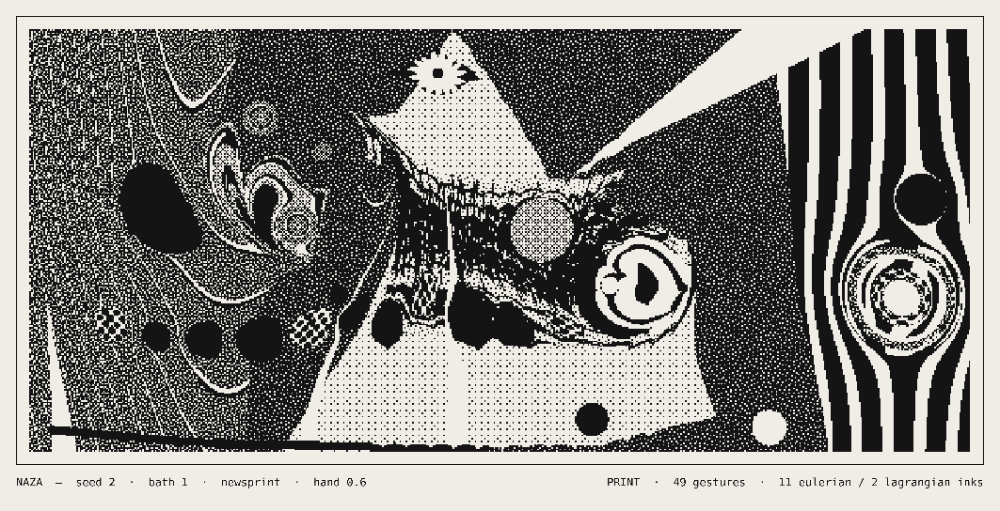

# 052 — NAZA

Titled by the artist after a documentary about collateral deaths.

NAZA takes Guernica's proportion — 776.6 × 349.3 cm, a plate 2.22 times as wide as it is tall —
and its grisaille, and the structure of its ground: a dark field with two wings, a pyramid of
light rising to the centre, a beam from the upper right, a band of newsprint across the body of the
light, a jagged lamp at the apex, shards rising from the floor and one fallen diagonal. It takes
none of its figures. Then the ground is cut: salvos of dark drops fall across it one after another,
combs tear it, swirls turn it, and the paper goes down on whatever is left. Each bath is a new
ground and a new score; each ends in a print.

**Mechanism (one sentence):** every gesture is an exact, invertible map of the plane, so the bath
at time *t* is found by pulling each pixel back through the gestures that have started, newest
first, until it lands in a drop's ink or on the ground — nothing is simulated or stored between
frames, and any moment of any bath renders directly from (seed, bath, t).

The engine was built as *Two Observers* in this folder and renamed when the work was titled; the
observers are still how it sees.

## Format and ground (Guernica)

- **Plate:** 776.6 : 349.3 (2.2233 : 1), height 1 in plate units, origin at the centre, y down.
  Prints are about 6,000 px wide; the plotter layer is 380 × 171 mm.
- **Grisaille in one bit:** paper and ink only; every grey is a screen.
- **Ground, in order from the back** (all windows are convex quads; a triangle repeats a corner):
  - the night: near-black (tone 0.06 – 0.16) through blue noise;
  - the left wing: a tall plane to 44 – 62 % of the way out, contour field or bands, dark;
  - the right wing, the house: vertical stripes, or Soto's panel (below) when Soto is present;
  - the pyramid of light: apex near the top centre, base across the lower third, tone 0.84 – 0.93;
  - newsprint across the body of the light (with probability *newsprint chance*, 0.9): the wire
    field below, in a skewed band;
  - the beam: a white triangle from the top right edge to the centre;
  - three to five shards rising from the bottom edge, white or grey, leaning;
  - the fallen diagonal: one long thin black bar across the lower left;
  - the lamp: a jagged eye — a star of 13 – 18 points with a black pupil, in an almond.
- **Inks for drops:** black twice as likely as any other, white, two greys, a ringed ink, a
  striped ink.

## The gestures

Every gesture is one of Lu, Jaffer et al.'s marbling maps (*Mathematical Marbling*, IEEE CG&A
2012), with a start, a duration and smooth-step progress *s*:

- *drop* at *c*, radius *r*: outside points move out, `p' = c + (p − c)·√(1 + r²s/|p − c|²)`;
  pulled back by `√(1 − r²s/|p' − c|²)`, and a point inside the disc is that drop's ink;
- *comb* of *n* tines along *M*: `p' = p + z s α/(d + α) · M`, *d* the distance to the nearest
  tine — the shift is along *M*, so *d* is unchanged and the inverse is a subtraction;
- *wave*: a shift along the normal by `A s sin(ω u + φ)`, *u* the position along *M*;
- *swirl* about *c*: a rotation by `z s α/(|r − R| + α) / r`, radius preserved.

**Movements:** a *salvo* is 6 – 13 dark drops (three in four black) laid along a line 0.9 – 1.6
half-plates long, each opening in 0.22 – 0.45 s, 0.09 – 0.2 s apart. Every bath has at least one
salvo, set among stones (concentric drops), combs drawn back and forth, a fine comb, waves, swirls
and scatters, in one of five seeded orders, always ending on drops. Over 900 baths: 32 – 69
gestures (5th – 95th percentile, median 52), 23 – 40 s of work, then a six-second hold on the print.

## The two observers

- **Eulerian:** a fixed screen on the glass — Bayer 8 × 8, or a 64 × 64 blue-noise screen made at
  load by void-and-cluster (Ulichney 1993).
- **Lagrangian:** a screen in the ink's own coordinates — dots or lines, combed with the ink.
- **Hand-off:** where the carried screen's period falls under *resolvable period* (2.5 px), the
  pixel is read through blue noise instead; the border is a contour of compression.

## Observers from physical work

- **Soto** (*Vibrations*, rods before striped panels, from the late 1950s). In NAZA the house is the
  panel: when Soto is present (*soto chance* 0.7; 638 of 900 baths) the right wing becomes a fixed
  vertical panel — period *soto panel* cells (4) — seen through ink carrying its own near-vertical
  lines at 0.93 – 0.97 or 1.03 – 1.07 of the panel's pitch, up to ±3.4° off it. Ink where either
  covers. The pitches beat into moiré bands that move as the comb shears the ink; the pointer slides
  the panel through one period. A few drops carry Soto glass too.
- **Mellan** (*The Sudarium of Saint Veronica*, 1649). About 40 % of the larger drops (radius ≥
  0.05) become spheres lit from the upper left, engraved by one Archimedean spiral at 70 – 100
  turns per plate unit, its width the darkness, carried by the ink (*mellan chance* 0.8).
- **Polke's hand** (the raster paintings, from 1963). The carried screens are painted: each dot
  wanders (±16 % of the pitch at full hand), grows or shrinks (±30 %), goes oval (±22 %) and lobed
  (±14 %); one in twenty is left out and about one in seventy blots into its neighbours; ruled
  lines waver (±21 %), thicken and thin (±35 %) and break. All of it is hashed from the cell, so it
  is stable in time and combed with the ink; the fixed screens stay machined. *hand* 0.6.
- **The newsprint** is a wire field taken from a line etching shared as a reference (artist not
  identified here): 16 – 30 taut wires, bursts of short vertical strokes hanging from them
  (densest a third of the way down, spikes off the top wires), bare wires crossing below, and
  plate tone between, read through blue noise. Wire and stroke widths never fall below about half
  a pixel.

## Prints, scores, the plotter

- **P** — the print: the screen's own bits enlarged by a whole factor to about 6,000 px wide, on
  the paper with its rule and caption. No resampling.
- **V** — the plotter layer as SVG (380 × 171 mm plate, one pen): Mellan's spirals (up to five
  strands side by side where the engraving is dark) and the newsprint's wires and strokes, each
  pushed *forward* through the later gestures by the exact forward maps and clipped where later ink
  or another window covers them; stretched runs are bisected under 0.4 mm and the pen lifts where
  they stay torn. One Inkscape layer per drop, one for wires, one for strokes, one for the frame.
- **J** — the score as JSON: seed, bath, movement, the ground's quads, every ink with its observer
  and hand, every gesture with its times and parameters.
- **S** — the sheet as shown.

## Controls

Space pause / play · ← → scrub one second (Shift: five) · N / B next / previous bath · O the score
drawn over the plate · P print · V plotter SVG · J score · S sheet · R new seed · pointer across the
window: Soto's panel. Panel: *cell* (css px per dither cell, 2), *speed*, *lagrangian share*,
*gesture density*, *resolvable period*, *soto chance*, *mellan chance*, *soto panel*, *hand*,
*newsprint chance*. URL: `?seed=…&bath=…&t=…&pause=1&par=…` reproduces a moment.

## Files

- `marble.js` — the score (ground, inks, salvos and the rest), blue noise, the pull-back and every
  observer on the CPU, the forward maps and the plotter layer, packing for the shader, the JSON
  record. Runs in Node.
- `sketch.js` — the WebGL2 fragment shader (the same arithmetic per pixel), the sheet, the bath
  life cycle, exports. Without WebGL2 it falls back to the CPU path.

## Verification

- GPU against CPU, headless Chromium (SwiftShader), grid 387 × 174: the shader's bits agree with
  `marble.js` on 99.98 % (seed 1, t 0, the ground), 99.74 % (seed 2, the print), 99.93 % (seed 3,
  t 20, panel shifted 1.5 cells), 99.92 % (seed 4, the print) and 99.99 % (seed 5, t 8) of cells.
- Forward against inverse: 4,000 points pushed forward from a random gesture to the end of five
  NAZA scores and pulled back return to within 1.2 × 10⁻¹⁴ plate units.
- 900 scores (seeds 1 – 300, baths 1 – 3): no non-finite parameter; every bath has a salvo;
  newsprint in 822, Soto in 638, Mellan in 724; at most 15 of the shader's 16 material slots and
  12 of its 12 window slots.
- Plotter layer at the print, seeds 2, 4, 5: 16 – 23 wires and 1,031 – 1,642 strokes drawn, 0 – 8
  Mellan drops, 1,221 – 1,802 polylines, 0.6 – 2.1 MB, 140 – 460 ms in Node.
- Page life cycle: score overlay, print, score and plotter downloads, the next bath with the peel,
  0 page errors. A print at a 1400 × 800 window is 6,378 × 3,267 px.

## Known limits

- Bits are reproducible from (seed, bath, t, parameters) to the agreement above; another GPU can
  differ on pixels at a threshold. The JSON score is the exact record.
- Guernica is the source of the proportion, the grisaille and the ground's structure only; no
  figure, motif or passage of the painting is reproduced.
- The work's title and subject are the artist's; nothing in the piece encodes data about any event.
- Carried screens and Soto's lines are fixed in plate or cell units, so a small window shows coarser
  grain and more hand-off than a large one, and a print records the screen it was taken from.
- Cost grows with gestures started (up to 160 per pixel per frame). Frame times were measured only
  under SwiftShader (about 110 – 160 ms at 387 × 174, CPU-emulated), not on hardware GPUs.
- The panel follows the pointer only; device tilt is not read.
- A comb's progress scales its displacement; a stylus front travelling along the stroke is not
  modelled.
- The caption is antialiased text; the plate alone is strictly two colours.
- The contact-sheet button opens one WebGL context per tile; browsers cap live contexts, untested.
