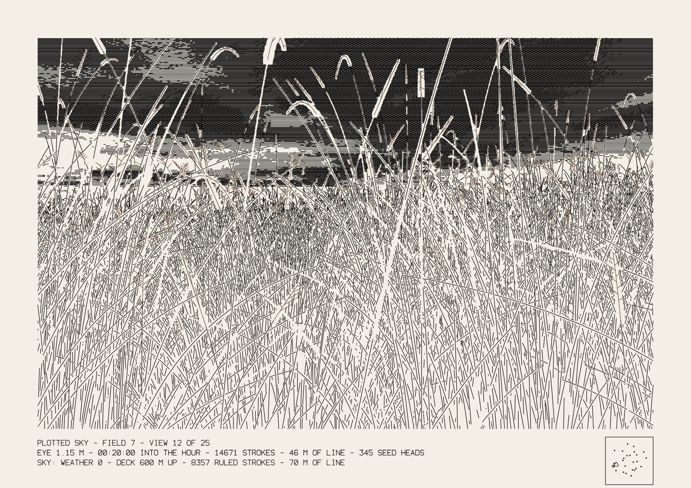
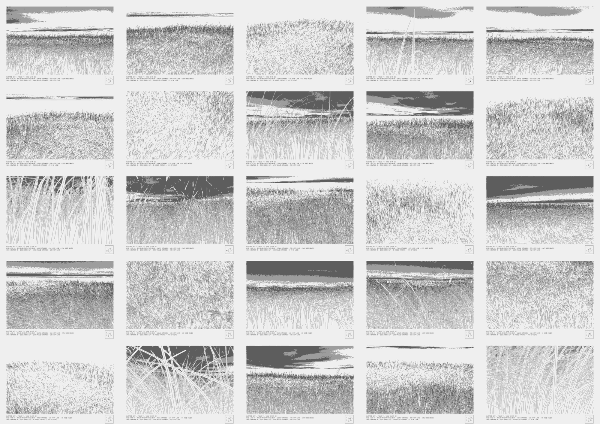
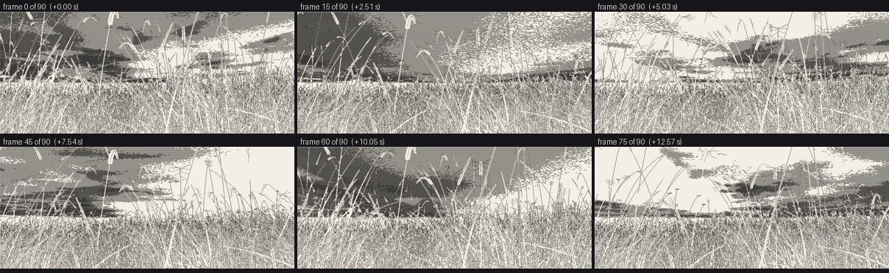

# 059 — Plotted Sky

*An engraver's sky over [048 Plotted Field](../048-plotted-field/).* The grass is 048, unchanged in
what it draws. Above it, one cloud deck per field, drawn the way engravers ruled skies:
horizontal lines, more lines between them where the tone deepens, a cross-ruling in the darkest
cloud. Lit cloud is where the pen lifts, as moonlit grass is in 048.

## Where the clouds come from

The deck's pattern is the folded cloud engine: Yohei Nishitsuji's twigl shader, transcribed in
[057](../057-after-nishitsuji/) and taken apart in [058 Folded Weather](../058-folded-weather/).
058 showed that the shader's colour reduces to two fields, density W and sky weight S. Here those
two fields set the tone of the ruling. The engine runs on the CPU in double precision, not on the
graphics card, so a sheet is the same SVG on every machine (see *Checks*).

## The rules

- **One deck per field, seen from every view.** The deck is a horizontal plane `deck` metres up
  (600 by default). For each point of the sheet, the ray from the eye is followed up to the
  plane; where it lands sets which part of the deck is drawn there. So all 25 views of a field look
  at the same clouds, each from its own place and heading. Views that look down without seeing
  the horizon get no sky (8 of field 7's 25).
- **The deck on the engine's plane.** A point on the deck at (x, z) metres is turned so the
  field's wind runs along the engine's x axis, divided by `scale` (3.5 km per unit), and shifted
  downwind by `drift` × the instant (8 m/s by default). The same `instant` that freezes 048's
  wind therefore also places the clouds, and the engine's slow camera sway is set from it too.
- **The engine's plane has a usable band.** 058 measured that across the wind it holds only
  within about ±6 units. Beyond that the deck is mirrored back (a fold, so there is no seam). At
  the distances where that happens (over about 15 km) the clouds are thin slivers near the
  horizon, and the mirror does not read.
- **Recession.** From 25 km to 40 km the tone fades to nothing, so a band of bare paper sits on
  the horizon. As in 048, distance shows as fewer lines, not grey.
- **Tone.** `D = (smoothstep(0.04, 0.85, W) + 0.25·S) × gain`, faded with distance. Each weather is
  levelled: its gain makes a fixed 16 × 16 patch of the deck average 0.3, so dark and light
  weathers come out comparable, and every view of a field uses the same gain.
- **Ruling.** Lines every `ruling` mm (0.75). The main lines are drawn where D > 0.16, the lines
  between them where D > 0.46, and a cross-ruling at 28° (1.5 × the spacing) where D > 0.76.
  Each line's threshold wavers by ±0.07 every 0.9 mm, from a hash of the line and the position,
  so a change of tone ends in broken, flicked lines instead of a hard edge. Runs shorter than
  0.8 mm are dropped.
- **Hidden lines.** The sky is drawn after the grass, and only where 048's occlusion map is
  still empty. Before the sky is drawn, every ground cell is stamped, so a rise in the ground
  hides the horizon behind it.
- **The moon.** 048's moon (azimuth relative to the view, height in degrees) is drawn if it is
  in the frame, above the horizon and not hidden by grass. It is a ring 2.5 × its true size,
  with the ruling cleared out to 1.6 × its radius, and the deck's tone eases off within about
  20° of it. With 048's default (the moon behind the viewer's right shoulder) it is never in
  view; `moon` near 180° brings it in front.
- **Weather.** `weather 0` is the shader's own constants; 1–48 are 058's screened seeds, the
  same numbering as 058's Atlas.

## Measured (A3, field 7, defaults, weather 0, all 25 views)

| | min | median | max |
|---|---|---|---|
| Sky strokes (the 17 views with sky) | 260 | 1,646 | 8,357 |
| Sky line (m) | 2 | 22 | 71 |
| Time to rule the sky (Node, one core) | 0.04 s | 0.6 s | 0.8 s |

On view 12 (the preview) the sky adds 8,357 strokes and 70 m of line to the grass's 14,671 and
46 m, taking the plot estimate from about 160 to about 256 minutes at 048's assumed speeds. The
sky is on the same pen as the grass (layer `3 sky`), so it adds no pen change. All 25 views:

## Checks

| Claim | How it was checked |
|---|---|
| 048's own sheets are unchanged | The hook only runs when `extend` is passed. The committed and the modified `field.js` give identical SVGs (SHA-1) for field 7, views 1, 5, 12 and 24, and the map |
| Same settings, same file | Two builds of field 7, view 12, weather 5 give the same SHA-1; a different `instant` gives a different file |
| The CPU engine is the shader | On the original's 5 × 5-unit frame at t = 3, W's 5th / 50th / 95th percentiles are 0.111 / 0.340 / 0.631 on the CPU and 0.111 / 0.341 / 0.631 on the GPU; S matches to 0.001 |

Not done: plotting a sheet on a real machine, and running `vpype` on the files (not installed
here). The ruling at 0.75 mm with a 0.3 mm pen has not been tried on paper; if lines bleed,
raise `ruling` to 0.9–1.0.

## The change to 048

`field.js` gained an optional `extend` hook in `build`. When it is present, every remaining
ground cell is stamped into the occlusion map, and the hook receives the camera, its basis, the
eye, the lens, the frame, the occlusion map and the moon direction. It may return extra pen layers
(placed before the caption), a caption line and a title. When it is absent, nothing in the
output changes. 048's panel and wall do not use it.

## In motion (`motion.html`)

The still sheet freezes one instant. Both halves of the piece already had a loop in them, and the
motion page runs them together, as a flip-book of complete plotted sheets.

- **The grass:** 048's wind is a train of gusts, `sin(along · 0.33 − 1.25 t + warp)`, so it repeats
  exactly every 2π / 1.25 = 5.03 s. A loop of a whole number of gusts closes: 2, 3 (default) or
  4 gusts, 10.05, 15.08 or 20.11 s.
- **The sky:** 058's Drift. The fold constants (offset x and z, box x and z, the tied y pair) move
  on a closed path with integer frequencies, once or twice per loop, with 058's amplitudes. The
  deck re-forms in place. The engine's own camera sway is held still in motion: its loop closes
  only after 5 cycles, which on a 15 s loop is a lurch every 3 s.
- **One exposure:** a moving deck is levelled once, at the start of its loop, so clouds gather and
  clear (the sky's ink runs from about 9 m to 88 m over the loop) without the whole sky brightening
  and dimming.
- **No flicker in the distance:** 048 thins distant blades and dithers hair-thin ones with a random
  sequence seeded by the instant, which would make far grass boil from frame to frame. 048's
  `stable` option (added for this) draws those choices from each blade's own hash instead, so a
  blade is kept or dropped the same way in every frame.
- **Every frame is a plottable sheet:** hidden lines, light and sky are worked out per frame.
  *Save SVG* writes the frame on screen.
- **Building:** a frame takes about 1.5–2.8 s, so a pool of Web Workers (up to 6) builds them,
  and the loop starts playing with the frames that are ready. The default, 3 gusts at 6 frames a
  second, is 90 frames: about a minute and a half on 3 workers. Frames are kept as 16-bit
  coordinates in 0.01 mm steps (about 0.6 MB a frame).

### On paper: the chronograph

Motion on a single sheet, as a chronophotograph: three instants a third of a gust apart
(1.68 s), each instant's grass in its own pen (black, sepia, blue-grey), each planted at half
density so the sheet carries about 1.5 × the grass of a still. The sky is ruled once, from the
first instant, so it is cut away only where that instant's grass stands: the first instant also
appears as white stalks against the sky. *Save SVG* writes it with one layer per pen.

### Checks

| Claim | How it was checked |
|---|---|
| The loop closes | Frame 0 and frame *n* (one loop later) of field 7, view 12 have the same strokes in grass, seed heads and sky; the largest coordinate difference is 1.2 × 10⁻¹¹ mm. Only the caption's clock differs |
| 048 and the still sheets are unchanged | `stable` and `loop` are off by default; the committed and modified files give identical SVGs for 048 (field 7, views 1, 5, 12, 24) and 059 (three view/weather pairs) |
| The page works | Served locally in headless Chromium: 60 frames built on 3 workers and played with no console errors; consecutive screenshots 0.83 s apart differ in 23% of pixels; the chronograph built in 1.9 s |

Not done: a plot of the chronograph on a real machine.

## Live (`live.html`)

The flip-book above is plotted sheets in sequence: each takes 1.5–2.8 s to build, so it plays at
6 frames a second, and every frame re-decides which lines are hidden and which ruled dashes are on.
Lines jump. The live view works the way the shader pieces (057, 058) do, and the way a live grass
field on the graphics card (such as Leander Herzog's *Field*, read for analysis only, no code
taken) works: it recomputes the sheet at screen rate from continuous functions.

- **The blades:** 048's engine plants the view once (`collect`, a new optional hook: each blade's
  root, length, lean and seed head before the wind bends it). The vertex shader then applies 048's
  wind formula to every blade at the current instant, so the gusts are 048's, at full frame rate.
- **Hidden lines:** each blade also gets a paper-coloured body, and the ground is a paper-coloured
  surface; the depth buffer hides what lies behind them. Bodies are sized as 048's occlusion map
  stamps them (rounded out to whole 0.2 mm cells, at least two cells wide).
- **Light:** 048's moon sheen per vertex; where it passes the limit the pen lifts.
- **Seed heads:** 048's head geometry (spine, nod, 5–10 alternating spikelets), with each head's
  random numbers drawn from its own sequence, as 048 draws them.
- **The sky:** the folded engine fills sky.js's 1.2 mm tone grid on the GPU (every other frame),
  and a ruling pass draws the three line families from it. Each line's threshold wavers smoothly
  along its length (sky.js `ditherSmooth`, also new), so as the deck re-forms the ends of the
  lines slide instead of jumping. The deck goes round 058's drift path once a minute.
- **Pause and Save SVG** rebuilds that exact instant on the CPU (`stable`, the same deck phase,
  `ditherSmooth`) as a plottable sheet.

The screen is a close likeness of the plot, not the plot. Measured at one instant (field 7, view
12, t = 7.3 s), as the share of dark pixels in each band, live against the exported sheet: sky
4.3% / 5.1%, far grass 39.7% / 32.4%, middle 33.7% / 28.5%, near 17.7% / 19.0%. The far grass is
denser live because the CPU's occlusion map also drops runs shorter than 0.35 mm and dithers
sub-cell bodies. Cloud positions, blade shapes and seed heads match.

Not measured: the frame rate on real graphics hardware. The tests here ran on a software
renderer (about 1 frame a second for 15,261 blades); the status line shows the live rate.

## Using it

- **URL:** `?seed=7&p_view=12&p_weather=0` plus every 048 setting. The sky's settings are
  `p_sky` (0 turns it off), `p_weather`, `p_deck`, `p_scale`, `p_drift`, `p_ruling`, `p_tone`,
  `p_cross`.
- **Keys:** as 048, plus `W` for the next weather.
- **SVG layers:** `1 grass`, `2 seed heads (pen 2)`, `3 sky`, `4 caption and map`.
- **Live:** `live.html?seed=7&view=12&weather=0&wind=0.6&speed=1` (`t=…` starts paused at that many seconds). Keys: space pause, H hide, S save SVG of this instant.
- **Motion:** `motion.html?mode=loop&seed=7&view=12&weather=0&gusts=3&fps=6` (or `mode=chronograph`). Keys: space pause, H hide, B rebuild. It needs to be served over http (workers do not load from `file://`).

## Files

- `sky.js`: the deck, the CPU engine, the ruling and the moon. Runs in a browser or in Node.
- `sketch.js`: 048's panel with a *sky* group.
- `live.js`, `live.html`, `live-page.js`: the live view (WebGL2).
- `motion.js`, `motion-worker.js`, `motion.html`, `motion-page.js`: the loop, the worker pool and the chronograph; `motion-frames.png`.
- `index.html`, `preview.png` (field 7, view 12), `views.png` (field 7, all 25 views).
- Uses `../048-plotted-field/field.js` and `../../assets/strokefont.js`.

## Credit

The cloud pattern is Yohei Nishitsuji's engine. The field, the views, the hidden lines and the
light are 048. The deck, the ruling, the levelling and the hook are this project's.
