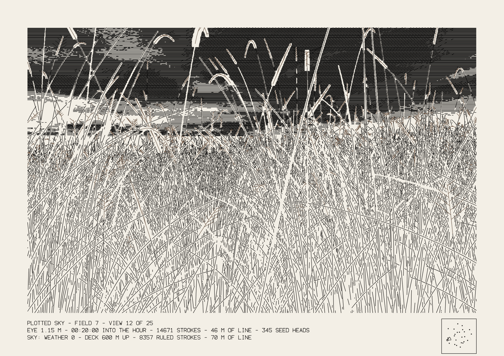
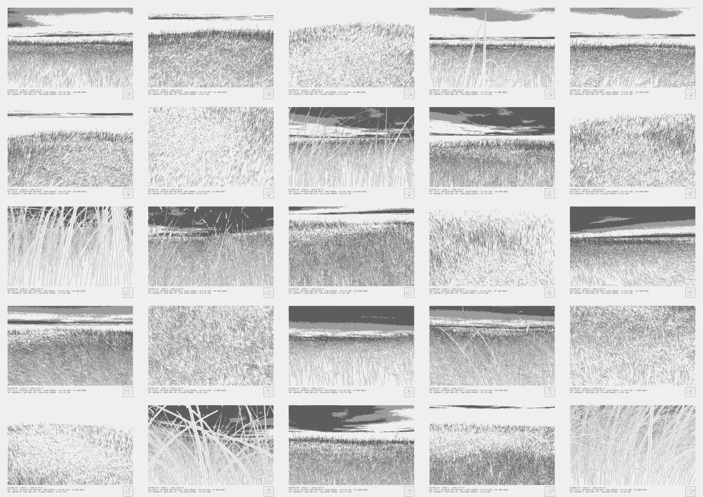

# 059 — Plotted Sky

*An engraver's sky over [048 Plotted Field](../048-plotted-field/).* The grass is 048, unchanged in
what it draws. Above it, one cloud deck per field, drawn the way engravers ruled skies:
horizontal lines, more lines between them where the tone deepens, a cross-ruling in the darkest
cloud. Lit cloud is where the pen lifts, as moonlit grass is in 048.

## Where the clouds come from

The deck's pattern is the folded cloud engine: Yohei Nishitsuji's twigl shader, transcribed in
[057](../057-after-nishitsuji/) and taken apart in [058 Folded Weather](../058-folded-weather/).
058 showed that the shader's colour reduces to two fields, density W and sky weight S. Here those
two fields set the tone of the ruling. The engine runs on the CPU in double precision, not on the
graphics card, so a sheet is the same SVG on every machine (see *Checks*).

## The rules

- **One deck per field, seen from every view.** The deck is a horizontal plane `deck` metres up
  (600 by default). For each point of the sheet, the ray from the eye is followed up to the
  plane; where it lands sets which part of the deck is drawn there. So all 25 views of a field look
  at the same clouds, each from its own place and heading. Views that look down without seeing
  the horizon get no sky (8 of field 7's 25).
- **The deck on the engine's plane.** A point on the deck at (x, z) metres is turned so the
  field's wind runs along the engine's x axis, divided by `scale` (3.5 km per unit), and shifted
  downwind by `drift` × the instant (8 m/s by default). The same `instant` that freezes 048's
  wind therefore also places the clouds, and the engine's slow camera sway is set from it too.
- **The engine's plane has a usable band.** 058 measured that across the wind it holds only
  within about ±6 units. Beyond that the deck is mirrored back (a fold, so there is no seam). At
  the distances where that happens (over about 15 km) the clouds are thin slivers near the
  horizon, and the mirror does not read.
- **Recession.** From 25 km to 40 km the tone fades to nothing, so a band of bare paper sits on
  the horizon. As in 048, distance shows as fewer lines, not grey.
- **Tone.** `D = (smoothstep(0.04, 0.85, W) + 0.25·S) × gain`, faded with distance. Each weather is
  levelled: its gain makes a fixed 16 × 16 patch of the deck average 0.3, so dark and light
  weathers come out comparable, and every view of a field uses the same gain.
- **Ruling.** Lines every `ruling` mm (0.75). The main lines are drawn where D > 0.16, the lines
  between them where D > 0.46, and a cross-ruling at 28° (1.5 × the spacing) where D > 0.76.
  Each line's threshold wavers by ±0.07 every 0.9 mm, from a hash of the line and the position,
  so a change of tone ends in broken, flicked lines instead of a hard edge. Runs shorter than
  0.8 mm are dropped.
- **Hidden lines.** The sky is drawn after the grass, and only where 048's occlusion map is
  still empty. Before the sky is drawn, every ground cell is stamped, so a rise in the ground
  hides the horizon behind it.
- **The moon.** 048's moon (azimuth relative to the view, height in degrees) is drawn if it is
  in the frame, above the horizon and not hidden by grass. It is a ring 2.5 × its true size,
  with the ruling cleared out to 1.6 × its radius, and the deck's tone eases off within about
  20° of it. With 048's default (the moon behind the viewer's right shoulder) it is never in
  view; `moon` near 180° brings it in front.
- **Weather.** `weather 0` is the shader's own constants; 1–48 are 058's screened seeds, the
  same numbering as 058's Atlas.

## Measured (A3, field 7, defaults, weather 0, all 25 views)

| | min | median | max |
|---|---|---|---|
| Sky strokes (the 17 views with sky) | 260 | 1,646 | 8,357 |
| Sky line (m) | 2 | 22 | 71 |
| Time to rule the sky (Node, one core) | 0.04 s | 0.6 s | 0.8 s |

On view 12 (the preview) the sky adds 8,357 strokes and 70 m of line to the grass's 14,671 and
46 m, taking the plot estimate from about 160 to about 256 minutes at 048's assumed speeds. The
sky is on the same pen as the grass (layer `3 sky`), so it adds no pen change. All 25 views:

## Checks

| Claim | How it was checked |
|---|---|
| 048's own sheets are unchanged | The hook only runs when `extend` is passed. The committed and the modified `field.js` give identical SVGs (SHA-1) for field 7, views 1, 5, 12 and 24, and the map |
| Same settings, same file | Two builds of field 7, view 12, weather 5 give the same SHA-1; a different `instant` gives a different file |
| The CPU engine is the shader | On the original's 5 × 5-unit frame at t = 3, W's 5th / 50th / 95th percentiles are 0.111 / 0.340 / 0.631 on the CPU and 0.111 / 0.341 / 0.631 on the GPU; S matches to 0.001 |

Not done: plotting a sheet on a real machine, and running `vpype` on the files (not installed
here). The ruling at 0.75 mm with a 0.3 mm pen has not been tried on paper; if lines bleed,
raise `ruling` to 0.9–1.0.

## The change to 048

`field.js` gained an optional `extend` hook in `build`. When it is present, every remaining
ground cell is stamped into the occlusion map, and the hook receives the camera, its basis, the
eye, the lens, the frame, the occlusion map and the moon direction. It may return extra pen layers
(placed before the caption), a caption line and a title. When it is absent, nothing in the
output changes. 048's panel and wall do not use it.

## Using it

- **URL:** `?seed=7&p_view=12&p_weather=0` plus every 048 setting. The sky's settings are
  `p_sky` (0 turns it off), `p_weather`, `p_deck`, `p_scale`, `p_drift`, `p_ruling`, `p_tone`,
  `p_cross`.
- **Keys:** as 048, plus `W` for the next weather.
- **SVG layers:** `1 grass`, `2 seed heads (pen 2)`, `3 sky`, `4 caption and map`.

## Files

- `sky.js`: the deck, the CPU engine, the ruling and the moon. Runs in a browser or in Node.
- `sketch.js`: 048's panel with a *sky* group.
- `index.html`, `preview.png` (field 7, view 12), `views.png` (field 7, all 25 views).
- Uses `../048-plotted-field/field.js` and `../../assets/strokefont.js`.

## Credit

The cloud pattern is Yohei Nishitsuji's engine. The field, the views, the hidden lines and the
light are 048. The deck, the ruling, the levelling and the hook are this project's.
